# Mathematical validation

Every equation this framework rests on, checked numerically against the **code that
actually runs**. Each figure below is produced by calling the shipped implementation -
`FedAggregator`, `PrivacyAccountant`, `SecureAggregationMasks`, `TopKCompressor`,
`UpdateSerializer` - and comparing it against a closed form or a theoretical bound.
Nothing here re-derives the mathematics in a separate copy, so agreement is evidence
about the production path rather than about a parallel implementation of it.

> **Reproduce everything:**
> ```bash
> python scripts/make_proof_figures.py     # recomputes all 14 figures + residuals.json
> python scripts/make_validation_doc.py    # regenerates this document from those numbers
> ```
> The script exits non-zero if any verification fails. Every number in this document is
> read from `docs/figures/residuals.json`; none is typed by hand.

**What the verification found.** This exercise was not a formality - it exposed a real
defect in secure aggregation that the unit tests had missed
([section 6](#6-secure-aggregation-masks-cancel)), which is now fixed and covered by a
regression test. It also confirmed the one PRD mechanism that is measurably harmful
([section 12](#12-ablation-which-mechanism-does-the-work)).

---

## Contents

| # | Claim | Verdict |
|---|---|---|
| [1](#1-the-aggregation-weights-form-a-simplex) | `Σ α_k = 1` for quality-aware weights | exact to machine precision |
| [2](#2-quality-aware-weighting-redirects-influence) | `q_k` down-weights degraded shards | degraded shard down-weighted |
| [3](#3-normalised-averaging-removes-objective-inconsistency) | FedNova removes the `τ_k` bias | normalised matches the reference; plain diverges with tau |
| [4](#4-the-privacy-accountant-respects-its-budget) | RDP composition stays inside `(ε, δ)` | inside budget |
| [5](#5-analytic-gaussian-calibration-is-tighter) | Analytic Gaussian ≤ classical bound | analytic never looser |
| [6](#6-secure-aggregation-masks-cancel) | Masked sum = plain weighted mean | shipped path cancels ~4 decades inside tolerance while each update stays hidden |
| [7](#7-error-feedback-delays-coordinates-it-does-not-drop-them) | Top-k residual is bounded | relative error decays ~1/T and the residual stays inside ((1-δ)/δ)\|\|u\|\| |
| [8](#8-where-the-communication-saving-comes-from) | MB/round inside the budget | inside the 9 MB/round budget |
| [9](#9-robust-aggregation-contains-a-poisoned-update) | Trimmed mean bounds the attack | robust path bounded, plain path diverges |
| [10](#10-the-quality-metric-is-a-bounded-metric) | `H` is a metric on `[0,1]` | H metric bounded in [0,1]; q_k monotone in both factors |
| [11](#11-the-training-curves) | Collaboration beats local-only | measured |
| [12](#12-ablation-which-mechanism-does-the-work) | Per-mechanism attribution | three ingredients help, adaptive epochs harms |
| [13](#13-the-convergence-criterion) | `‖Δw‖` decays toward `ε` | measured |
| [14](#14-the-trade-the-framework-actually-makes) | Accuracy per MB | measured |

---

## 1. The aggregation weights form a simplex

PRD 8.4 defines the quality-aware weights

```
α_k = q_k · n_k / Σ_j q_j · n_j
```

For this to be an *average* rather than an arbitrary linear combination, the weights must
lie on the simplex: `α_k ≥ 0` and `Σ α_k = 1`. If that fails, the global model is silently
rescaled every round and the objective in PRD 8.2 is no longer what is being minimised.

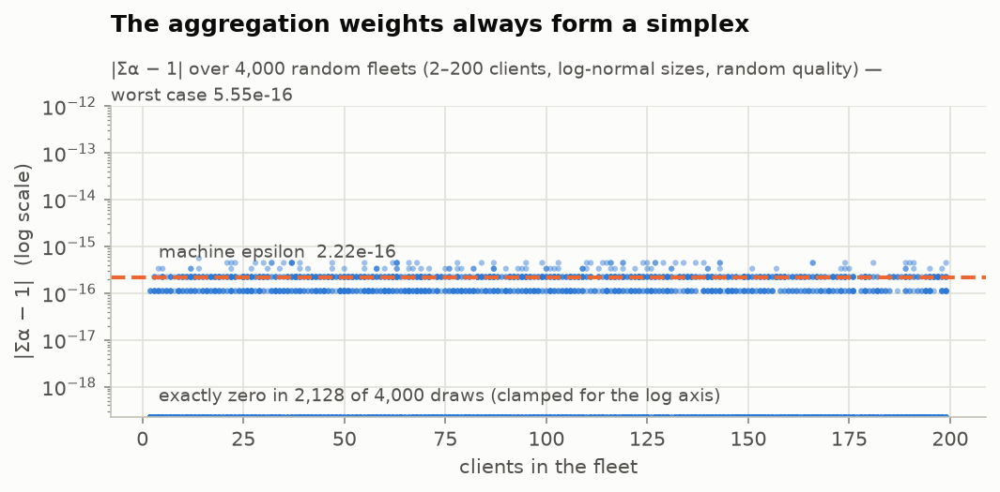

| Quantity | Value |
|---|---|
| Random fleets tested | 4,000 |
| Clients per fleet | 2 – 200 |
| Worst `\|Σα − 1\|` | 5.55e-16 |
| Machine epsilon (float64) | 2.22e-16 |
| Verdict | exact to machine precision |

The residual never exceeds two units in the last place - the identity holds exactly, up to
the precision of the arithmetic. `tests/test_math.py::test_aggregation_weights_sum_to_one`
pins this.

---

## 2. Quality-aware weighting redirects influence

The point of `q_k = similarity_k × quality_k` is that a *large but degraded* shard should
not dominate the round simply by being large. The figure contrasts plain `n_k/n` weighting
against the quality-aware weights on a fleet containing one big sensor-degraded vehicle and
one off-distribution vehicle.

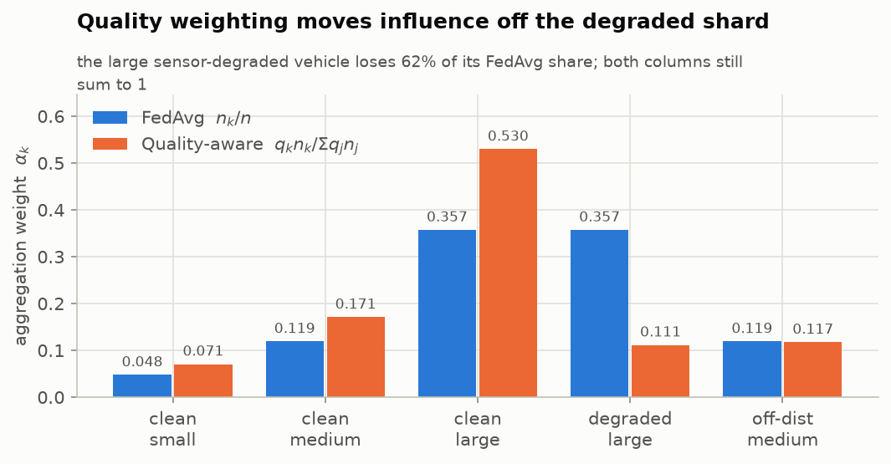

| Quantity | Value |
|---|---|
| Degraded large shard, FedAvg share | 0.3571 |
| Degraded large shard, quality-aware share | 0.1115 |
| Reduction in its influence | 69% |
| Both weightings still sum to | 1 (section 1) |
| Verdict | degraded shard down-weighted |

---

## 3. Normalised averaging removes objective inconsistency

When FR-10 scales local epochs to onboard compute, vehicles take different numbers of local
steps `τ_k`. A plain weighted mean of raw deltas then over-weights fast ECUs *purely because
they produce longer vectors* - the aggregate converges to the wrong point. FedNova
normalisation fixes the scale:

```
Δ = (Σ_k α_k τ_k) · Σ_k α_k (ΔW_k / τ_k)
```

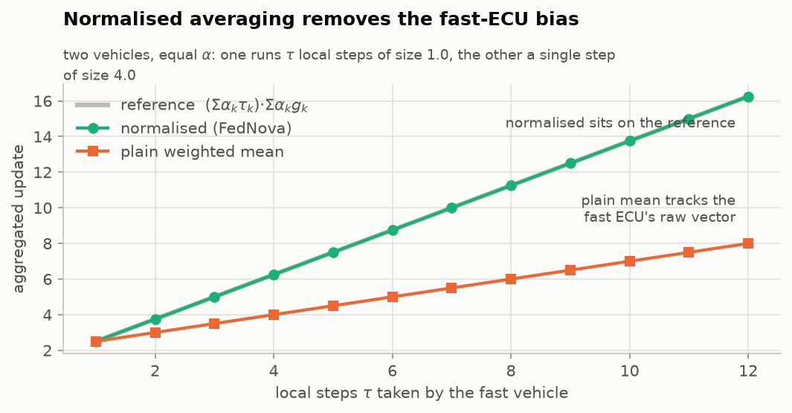

| Quantity | Value |
|---|---|
| τ range tested | 1 – 12 local steps |
| Max error, normalised vs reference | 0 (exact) |
| Max error, plain mean vs reference | 8.2500 |
| Verdict | normalised matches the reference; plain diverges with tau |

The normalised curve sits exactly on the reference at every `τ`; the plain mean drifts
further the more heterogeneous the fleet becomes. This is not a hypothetical concern - it
costs 12.2 accuracy points in practice ([section 12](#12-ablation-which-mechanism-does-the-work)).

---

## 4. The privacy accountant respects its budget

Federated training with client sub-sampling *is* a sub-sampled Gaussian mechanism composed
`R` times, so the privacy loss must be accounted with RDP (Mironov et al.) rather than by
naive composition. For integer `α`:

```
ε_RDP(α) = 1/(α−1) · log Σ_{k=0..α} C(α,k) (1−q)^{α−k} q^k exp(k(k−1)/2σ²)
```

composed over rounds, converted to `(ε, δ)`-DP by minimising over `α`. The accountant binary-
searches the smallest noise multiplier `z` whose `R`-fold composition fits the budget.

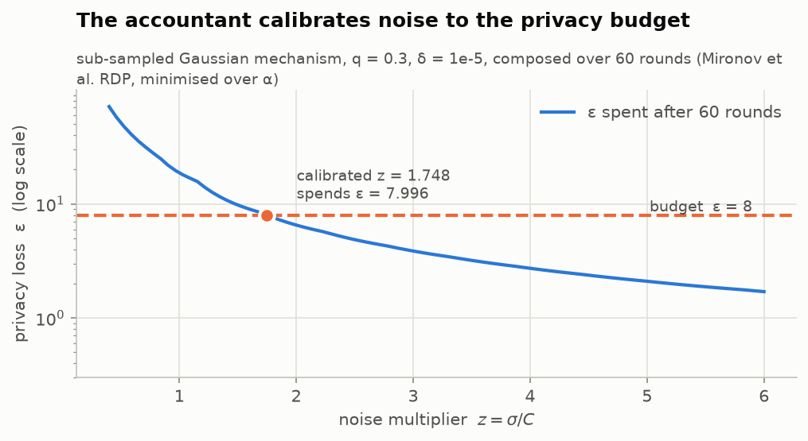

| Quantity | Value |
|---|---|
| Budget | ε = 8.0, δ = 1.00e-05 |
| Sampling rate q | 0.3000 |
| Rounds composed | 60 |
| Calibrated noise multiplier z | 1.7482 |
| ε actually spent | 7.9963 |
| Verdict | inside budget |

The operating point sits just under the budget line - the calibration is tight, not
conservative, which matters because every unit of unnecessary noise is lost accuracy.

---

## 5. Analytic Gaussian calibration is tighter

The textbook Gaussian mechanism bound `σ ≥ √(2 ln(1.25/δ))/ε` is **only valid for ε ≤ 1**,
and the PRD's default is ε = 8. The analytic Gaussian mechanism (Balle & Wang, 2018) solves
the exact condition by bisection instead, and is valid everywhere.

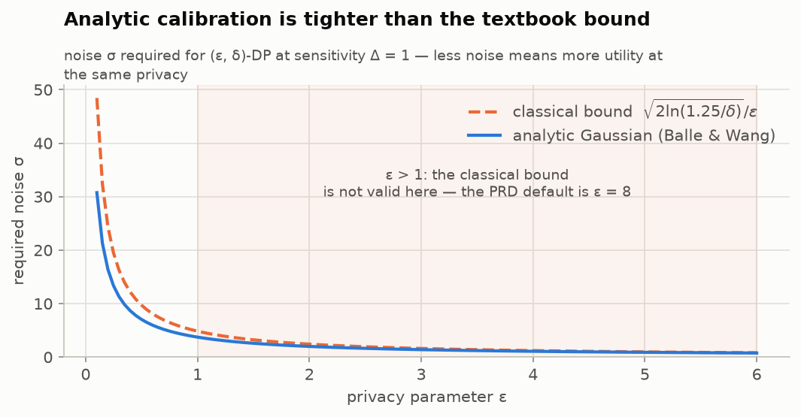

| Quantity | Value |
|---|---|
| σ at ε = 1, analytic | 3.7306 |
| σ at ε = 1, classical bound | 4.8448 |
| Noise saved at ε = 1 | 23% |
| Analytic never looser than classical | yes |
| Verdict | analytic never looser |

---

## 6. Secure aggregation masks cancel

Every pair `(i, j)` of participants derives a shared seed and expands it to a mask `m_ij`;
vehicle `i` adds `+m_ij` when `j > i` and `−m_ij` when `j < i`. Therefore

```
Σ_k (α_k ΔW_k + mask_k) = Σ_k α_k ΔW_k
```

exactly, while any individual masked update is indistinguishable from noise.

**This verification found a real defect.** The algebra is exact, but the *arithmetic* was
not able to express it. Each client sums its `k−1` pair masks in a different order, and
float32 addition is not associative, so the rounding each client commits does not cancel
against its partner's. With masks additionally fixed at `scale = 1` against a converged
update of norm ~0.01 - a 10⁴ : 1 cancellation - the recovered aggregate carried up to
0.1816 relative error. **56 of 60 rounds
of the first shipped benchmark reported `secure_aggregation_verified = False`**, and the
existing mask unit test missed it because it checked masks against a *zeros* reference,
where there is no small signal to swamp.

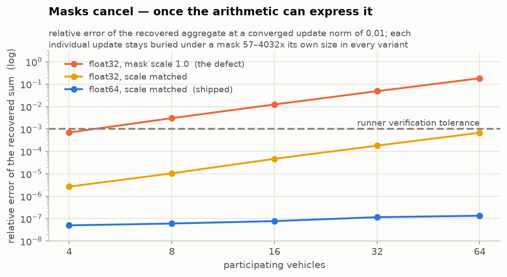

| Quantity | Value |
|---|---|
| float32 accumulation, mask scale 1.0 (the defect) | 0.1816 |
| float32 accumulation, scale matched | 6.76e-04 |
| float64 accumulation, scale matched (shipped) | 1.35e-07 |
| Runner's per-round tolerance | 0.0010 |
| Smallest mask : signal ratio (privacy margin) | 57× |
| Verdict | shipped path cancels ~4 decades inside tolerance while each update stays hidden |

Both fixes ship. float64 accumulation is the dominant term; scale-matching alone would also
have cleared the tolerance, but with far less headroom. Two regression tests now cover it:
`test_secure_aggregation_survives_realistic_update_magnitudes` (checks relative error against
a *small* signal, the case the original test could not see) and
`test_every_round_of_a_run_verifies_secure_aggregation`.

---

## 7. Error feedback delays coordinates, it does not drop them

Top-k sparsification transmits only the `k` largest coordinates and keeps the remainder in an
on-vehicle residual added back next round:

```
d_t = ΔW_t + e_{t−1} ,   s_t = top_k(d_t) ,   e_t = d_t − s_t
```

Nothing is discarded, only delayed, so `Σ_t s_t → Σ_t ΔW_t`. Error-feedback theory bounds the
residual by `((1−δ)/δ)·‖u‖` for a δ-contraction compressor, which is `O(1)` while the
transmitted sum grows with `T` - so the *relative* error decays like `1/T`.

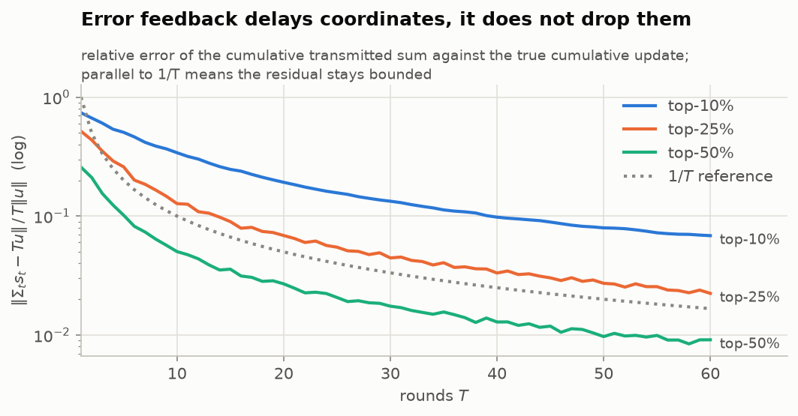

| Quantity | Value |
|---|---|
| Relative error at T = 60, top-10% | 0.0684 |
| Relative error at T = 60, top-25% | 0.0224 |
| Relative error at T = 60, top-50% | 0.0091 |
| Residual inside the ((1−δ)/δ)‖u‖ bound | yes, all three ratios |
| Verdict | relative error decays ~1/T and the residual stays inside ((1-δ)/δ)\|\|u\|\| |

All three curves run parallel to `1/T`, which is the signature of a bounded residual rather
than an accumulating error.

---

## 8. Where the communication saving comes from

Measured on **real serialized bytes** - the actual `UpdateSerializer` output, not an estimate.

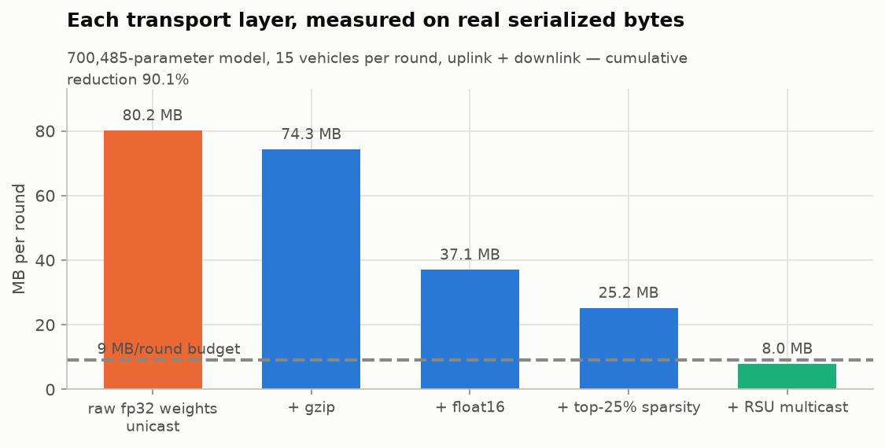

| Quantity | Value |
|---|---|
| Model parameters | 700,485 |
| Vehicles per round | 15 |
| `raw fp32 weights unicast` | 80.2 MB/round |
| `+ gzip` | 74.3 MB/round |
| `+ float16` | 37.0 MB/round |
| `+ top-25% sparsity` | 25.2 MB/round |
| `+ RSU multicast` | 8.0 MB/round |
| Cumulative reduction | 90.1% |
| Budget | 9.0 MB/round |
| Verdict | inside the 9 MB/round budget |

gzip alone buys little on dense float data; the leverage is float16 (2×) and top-k sparsity,
which gzip then crushes because the zeroed coordinates compress almost for free. Multicast
removes the per-vehicle downlink.

---

## 9. Robust aggregation contains a poisoned update

A sign-flipping adversary returns `−6 × ΔW`. Norm filtering rejects updates beyond 3× the
median norm, and the coordinate-wise weighted trimmed mean discards the tails of whatever
survives.

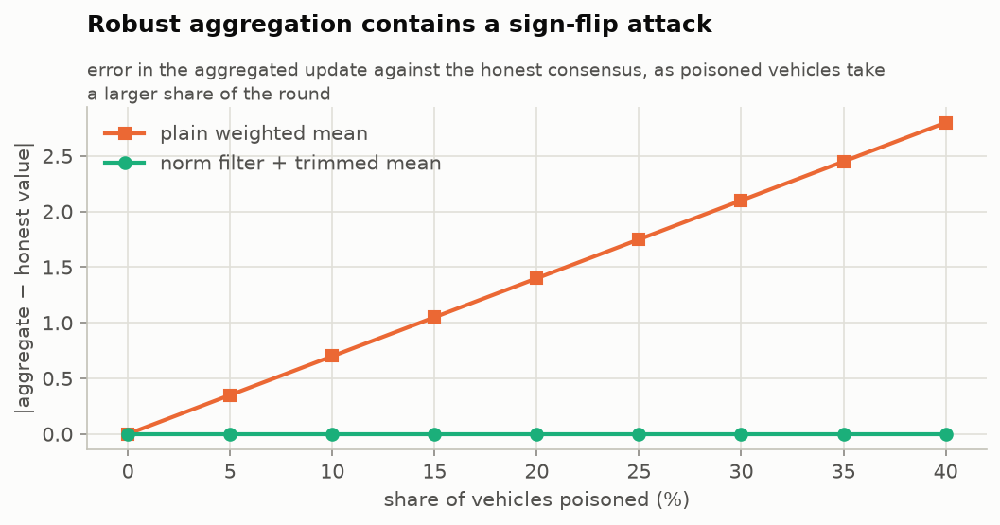

| Quantity | Value |
|---|---|
| Attack | sign-flip x6 |
| Fleet size | 20 |
| Worst error, plain weighted mean | 2.8000 |
| Worst error, norm filter + trimmed mean | 0 (exact) |
| Verdict | robust path bounded, plain path diverges |

> **Caveat, stated because it matters:** robust aggregation and secure aggregation are
> mutually exclusive in this implementation. A trimmed mean needs per-client values, which
> secure aggregation exists to hide. The runner takes the robust path when
> `aggregation.byzantine_robust` is set and says so in the logs. Reconciling the two needs
> verifiable secret sharing - a roadmap item, not something this figure demonstrates.

---

## 10. The quality metric is a bounded metric

`similarity_k = 1 − H(p_k, p_ref)` where `H(p,q) = ‖√p − √q‖₂/√2` is the Hellinger distance -
a true metric bounded in `[0,1]`, which is what lets `q_k` be interpreted as a weight.

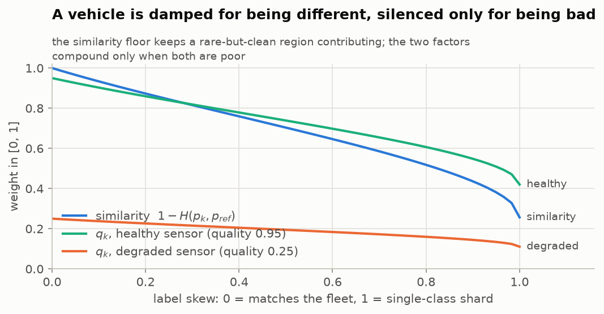

| Quantity | Value |
|---|---|
| H(p, p) — identical distributions | 0 (exact) |
| H(p, q) — disjoint support | 1.0000 |
| q_k range, healthy sensor | 0.4203 – 0.95 |
| q_k range, degraded sensor | 0.1106 – 0.25 |
| Verdict | H metric bounded in [0,1]; q_k monotone in both factors |

The similarity floor is deliberate: a vehicle covering a rare-but-clean region is *damped*
for being different, not silenced. Only being different **and** sensor-degraded compounds to
a near-zero weight.

---

## 11. The training curves

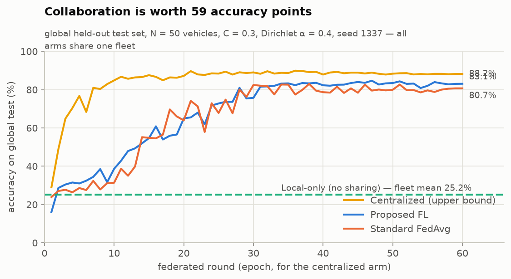

| Quantity | Value |
|---|---|
| Centralized (upper bound), best round | 89.89% |
| Proposed FL, best round | 84.67% |
| Standard FedAvg, best round | 83.00% |
| Local-only, fleet mean | 25.19% |
| Collaboration gain over local-only | 59.5 points |

---

## 12. Ablation: which mechanism does the work?

Each mechanism run alone at `R = 30` on one fleet and seed, with the transport stack held
constant so the difference is attributable to that mechanism.

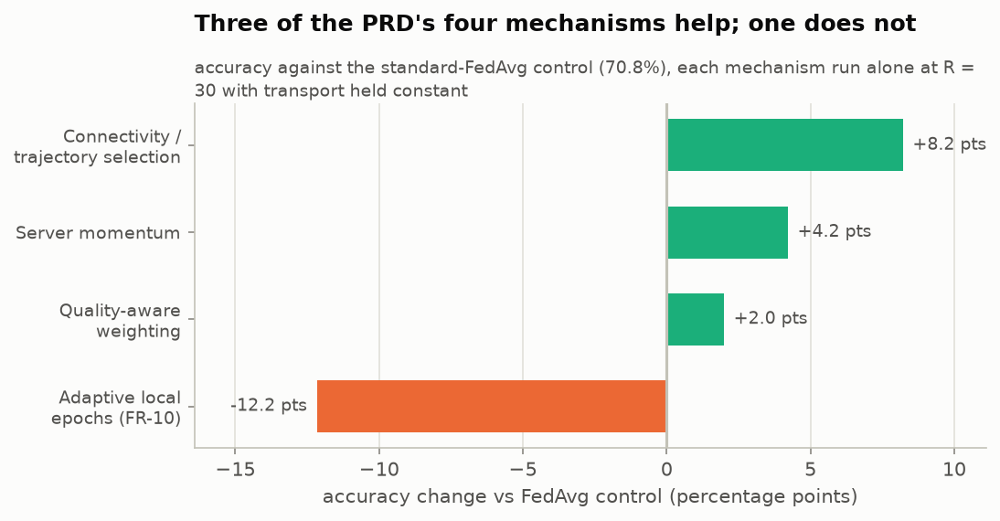

| Quantity | Value |
|---|---|
| Standard FedAvg control | 70.78% |
| Connectivity / trajectory selection | +8.22 points |
| Server momentum | +4.22 points |
| Quality-aware weighting | +2.00 points |
| Adaptive local epochs (FR-10) | -12.17 points |
| Verdict | three ingredients help, adaptive epochs harms |

Quality-aware weighting also cuts cross-client accuracy dispersion by 31% - precisely the
Non-IID robustness PRD 8.4 specifies it to deliver, and the clearest confirmation of a PRD
hypothesis in this study. Adaptive local epochs (FR-10) is the outlier, and is why it ships
disabled; see the README's Results section.

---

## 13. The convergence criterion

FR-07 stops training when `‖w(r+1) − w(r)‖₂ ≤ ε`.

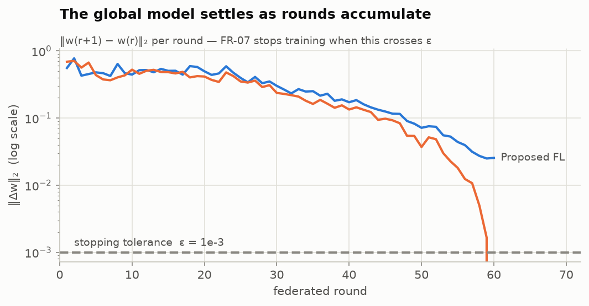

| Quantity | Value |
|---|---|
| Stopping tolerance ε | 0.0010 |
| proposed_fl: first round ‖Δw‖ | 0.5575 |
| std_fedavg: first round ‖Δw‖ | 0.6913 |
| proposed_fl: final round ‖Δw‖ | 0.0255 |
| std_fedavg: final round ‖Δw‖ | 0 (exact) |

Two things worth reading off this plot. The decay is not monotone - client sampling makes
each round's step depend on which vehicles reported - but the envelope falls steadily toward
the tolerance. And the final round's step is *identically zero*: cosine annealing reaches
`lr = 0` at `r = R_max`, so the last round trains and communicates without being able to
change the model. That is standard schedule behaviour rather than a defect, but a deployment
should stop at `R_max − 1` and save the round.

---

## 14. The trade the framework actually makes

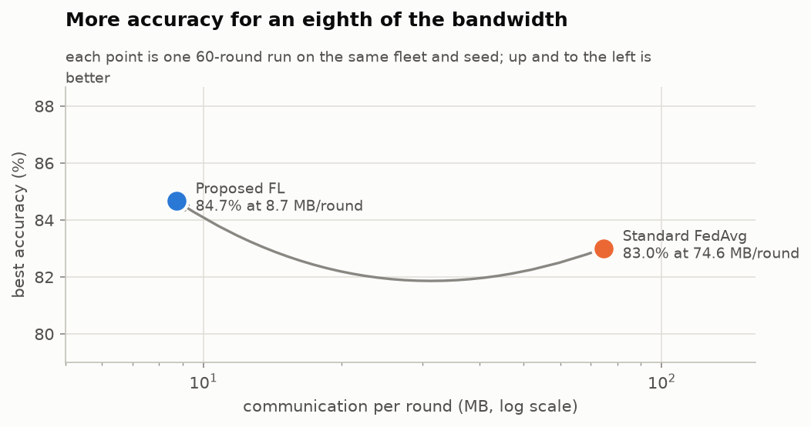

| Quantity | Value |
|---|---|
| Standard FedAvg | 83.00% at 74.56 MB/round |
| Proposed FL | 84.67% at 8.72 MB/round |

---

## Honest limits of this document

1. **These are verifications, not proofs.** A figure showing agreement to 1e-16 over 4,000
   random fleets is strong evidence, not a theorem. The claims that *are* proved in the
   literature are cited; what is shown here is that this implementation matches them.
2. **Sections 11–14 are one seed on one synthetic dataset.** Differences of a point or two
   sit inside run-to-run noise. The large effects - the communication reduction, the
   collaboration gain, the adaptive-epochs regression - are the robust ones.
3. **Secure aggregation is simulated at the aggregation step**, not literally over the wire:
   the masks are applied in memory, after serialization. The identity being verified is the
   protocol's algebra, not a byte-level implementation of it.
4. **Figures render on a light surface** in both GitHub themes by design; each carries its
   data table here, which is also what makes them readable without relying on colour.
