# How to run FL-AV — step by step, with screenshots

Every image below is a real capture: the terminal steps show the exact output of the command
(run on a 4-core CPU box with `configs/quick.yaml`), and the dashboard steps are browser
screenshots of `streamlit run dashboard/app.py`. To regenerate them yourself, see
[Regenerating these images](#regenerating-these-images).

| # | Step | Command |
|---|---|---|
| 1 | [Install](#step-1--install-dependencies) | `pip install -r requirements.txt` |
| 2 | [Test](#step-2--run-the-test-suite) | `python -m pytest -q` |
| 3 | [CLI help](#step-3--see-the-cli-commands) | `python -m fedav.cli --help` |
| 4 | [Fleet info](#step-4--inspect-the-fleet) | `python -m fedav.cli info --config configs/default.yaml` |
| 5 | [Quick run](#step-5--quick-smoke-run) | `python -m fedav.cli run --config configs/quick.yaml` |
| 6 | [Run outputs](#step-6--files-every-run-writes) | `ls runs/quick` |
| 7 | [Benchmark](#step-7--benchmark-all-four-arms) | `python -m fedav.cli benchmark --config configs/quick.yaml` |
| 8 | [Ablation](#step-8--ablation) | `python -m fedav.cli ablation --config configs/quick.yaml` |
| 9 | [Dashboard](#step-9--start-the-dashboard) | `streamlit run dashboard/app.py` |
| 10–17 | [Dashboard pages](#step-10--overview) | open <http://localhost:8501> |

---

## Step 1 — Install dependencies

```bash
python -m venv .venv && source .venv/bin/activate      # Windows: .venv\Scripts\activate
pip install -r requirements.txt
```

Python 3.11+ works (these captures used 3.13). Check the key packages are there:

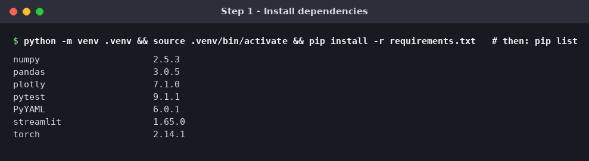

## Step 2 — Run the test suite

```bash
python -m pytest -q
```

All tests should pass before you trust any numbers:

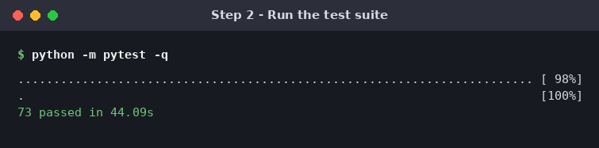

## Step 3 — See the CLI commands

```bash
python -m fedav.cli --help
```

Four sub-commands: `run`, `benchmark`, `ablation`, `info`. Any config field can be overridden
with `--set key=value` (e.g. `--set num_clients=100 train.rounds=20`).

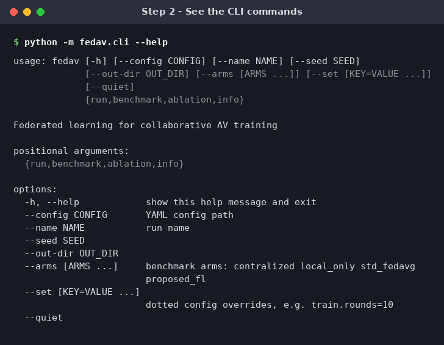

## Step 4 — Inspect the fleet

```bash
python -m fedav.cli info --config configs/default.yaml
```

Prints the model size, number of vehicles, samples, regions and weathers — no training.

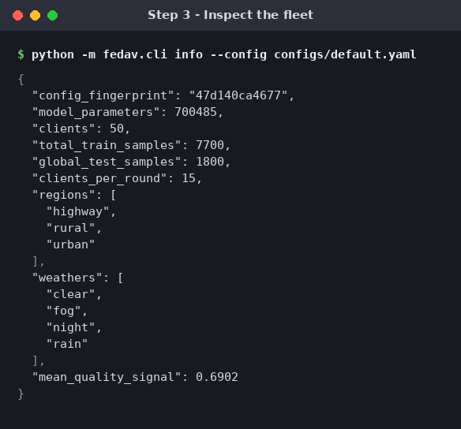

## Step 5 — Quick smoke run

```bash
python -m fedav.cli run --config configs/quick.yaml
```

12 vehicles, 8 rounds, about 40 seconds on CPU. One line per round
(`acc`, `mAP`, trajectory `ade`, `loss`, vehicles reported `|S|`, uplink `MB`, update norm
`||dW||`), then the final `summary.json`. The quick config is only a smoke test — accuracy stays
low after 8 rounds; the full experiment (`configs/default.yaml`, 50 vehicles, 60 rounds) reaches
about 82 % (see Step 10).

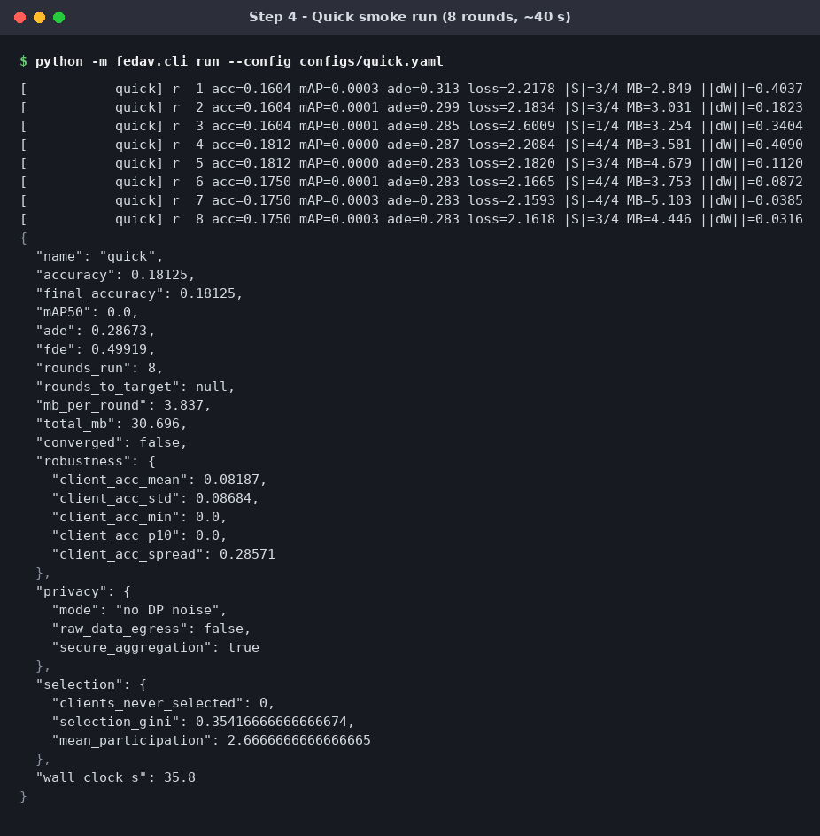

## Step 6 — Files every run writes

```bash
ls runs/quick
head -3 runs/quick/rounds.csv
```

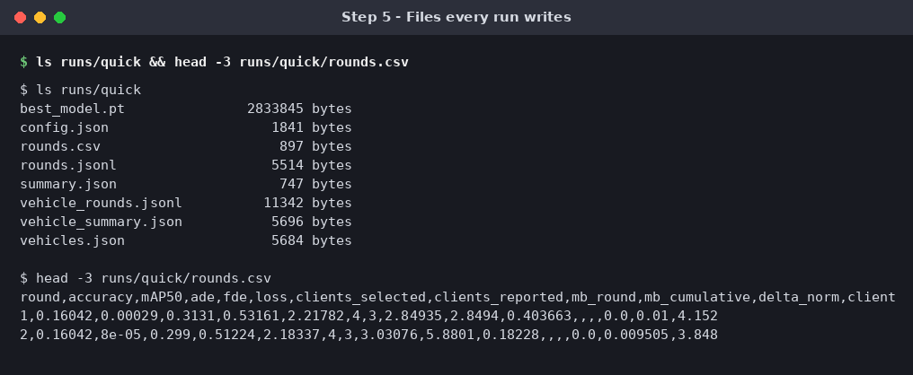

| File | Contents |
|---|---|
| `config.json` | exact config + fingerprint |
| `rounds.jsonl` / `rounds.csv` | one row of metrics per round |
| `summary.json` | final accuracy, MB/round, privacy, fairness |
| `vehicles.json`, `vehicle_rounds.jsonl`, `vehicle_summary.json` | per-vehicle profile and history |
| `best_model.pt` | best global checkpoint |

## Step 7 — Benchmark all four arms

```bash
python -m fedav.cli benchmark --config configs/quick.yaml     # ~3 min
python -m fedav.cli benchmark --config configs/default.yaml   # the full PRD experiment (long)
```

Trains Centralized, Local-only, standard FedAvg and the Proposed FL, then prints a comparison
table and the PRD 12.3 acceptance checklist (also written to `runs/benchmark_report.md`). On the
quick config the communication and fairness checks pass; the accuracy checks need the full run.

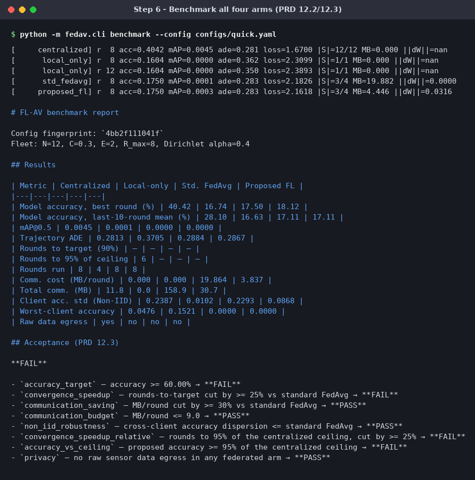

## Step 8 — Ablation

```bash
python -m fedav.cli ablation --config configs/quick.yaml
```

Switches each enhancement on by itself to show which one does the work.

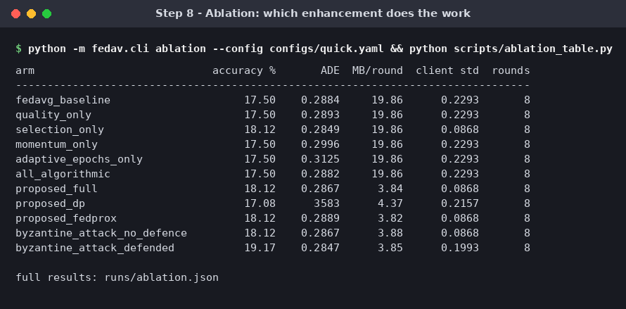

## Step 9 — Start the dashboard

```bash
streamlit run dashboard/app.py
```

Then open <http://localhost:8501>. Pick pages from the left sidebar.

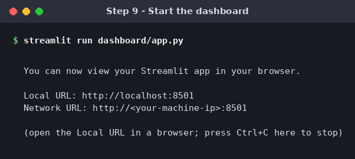

## Step 10 — Overview

Headline numbers for the full benchmark in `results/benchmark` (Proposed FL 82.2 %, 8.7 MB per
round, 88 % less uplink than FedAvg) and the PRD 12.3 acceptance table.

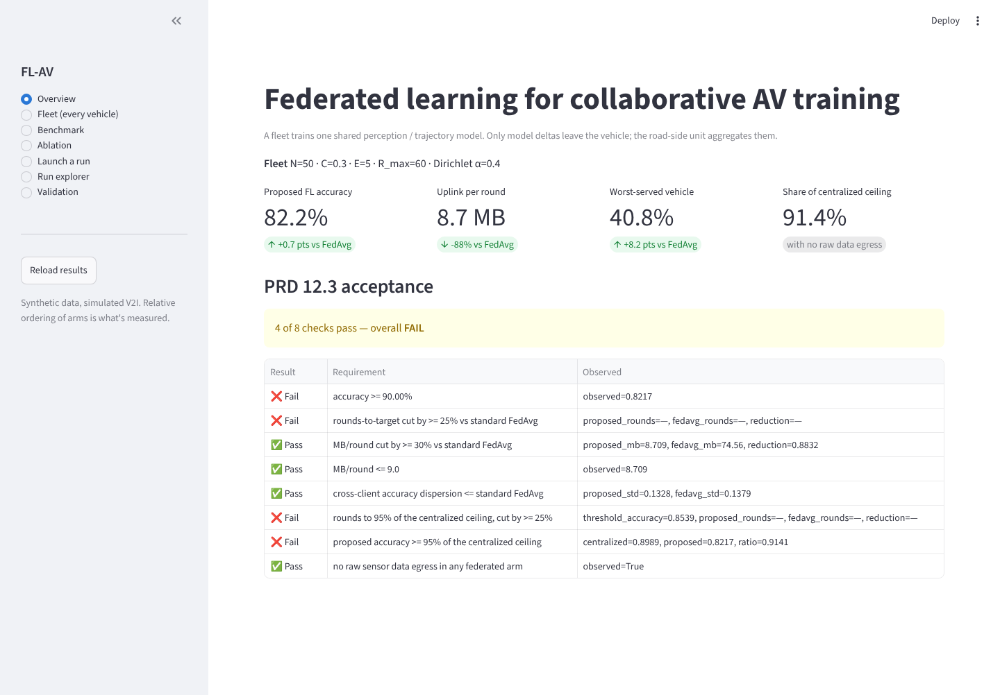

## Step 11 — Fleet (every vehicle)

Every car in one table (filter by region / weather / calibration, CSV export), accuracy per car
from worst to best, and sensor quality / label similarity against accuracy. Tabs give a per-car
drill-down, round × vehicle heatmaps and region/weather breakdowns.

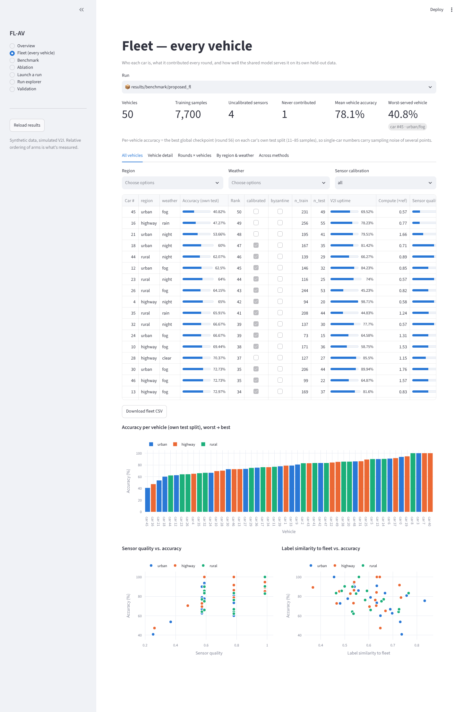

## Step 12 — Benchmark

The four arms round by round: accuracy, cumulative uplink, loss, trajectory ADE, the final-metrics
table and the worst-served vehicle.

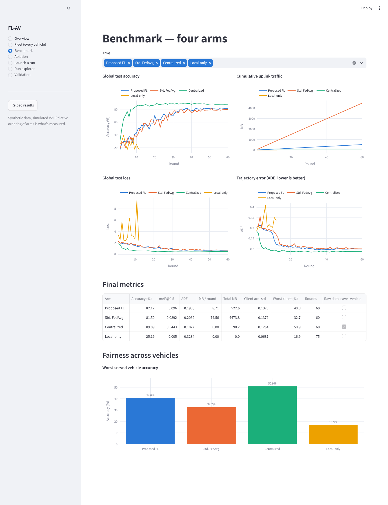

## Step 13 — Ablation

Choose a study (`ingredients`, `attribution`, `fix`) to see each enhancement in isolation.

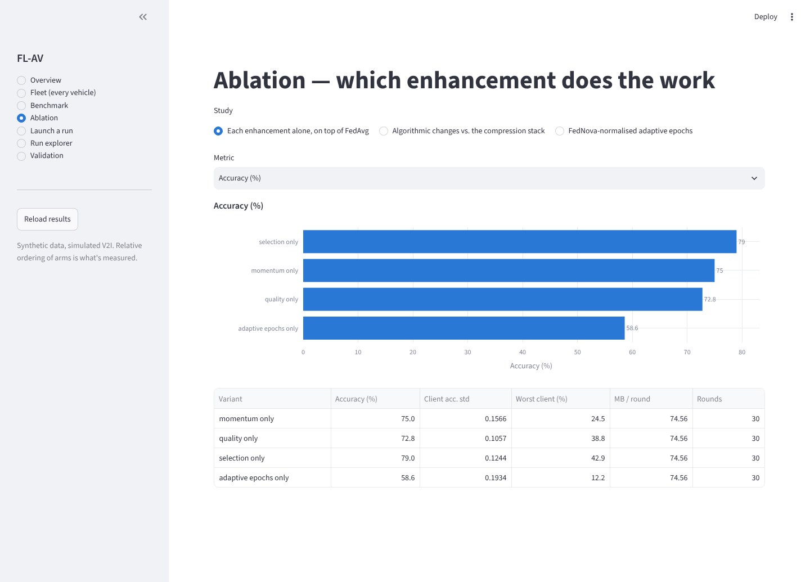

## Step 14 — Launch a run

Set N, C, E, rounds, quality/trajectory-aware, DP ε, top-k and the Byzantine defence, then press
**Start run**. It runs the same CLI as Step 5.

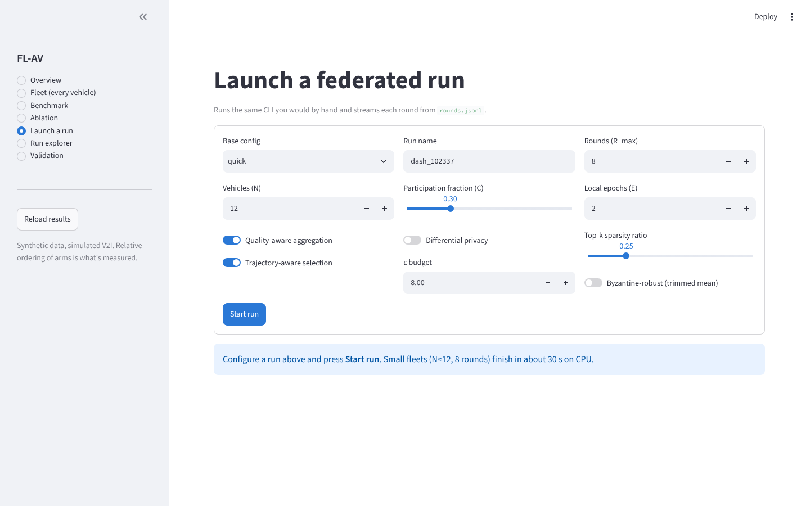

## Step 15 — Watching the run finish

Rounds stream in live: accuracy, loss, mean quality weight, uplink, update norm, and which vehicle
took part (or dropped out) in each round.

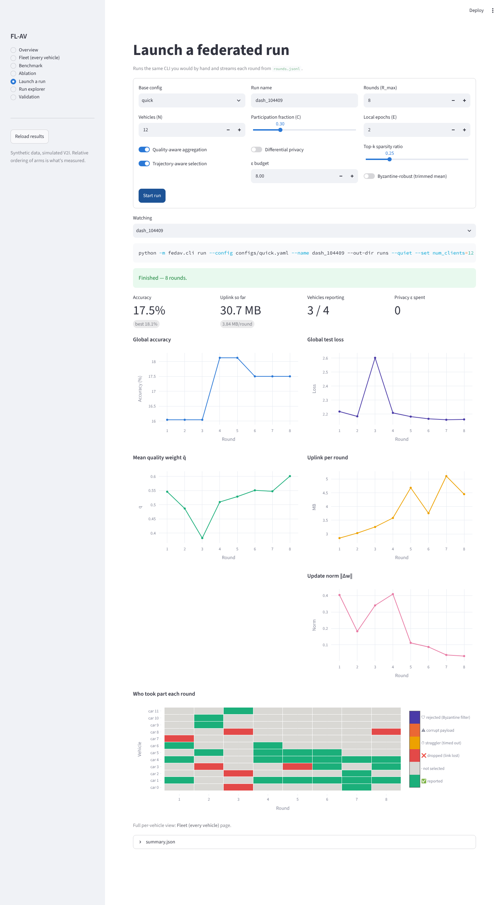

## Step 16 — Run explorer

Open any run under `runs/` or `results/`: per-round table, summary, config and CSV download.

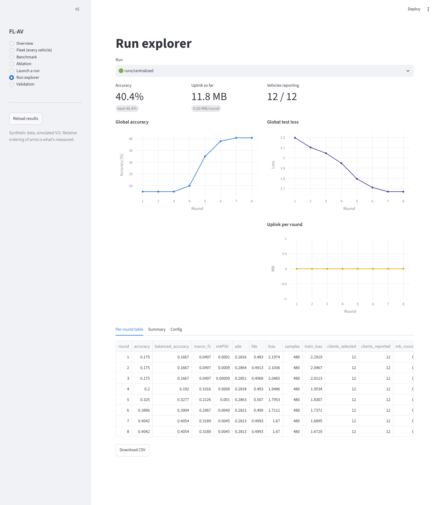

## Step 17 — Validation

The 14 mathematical-validation figures from
[docs/MATHEMATICAL_VALIDATION.md](../MATHEMATICAL_VALIDATION.md).

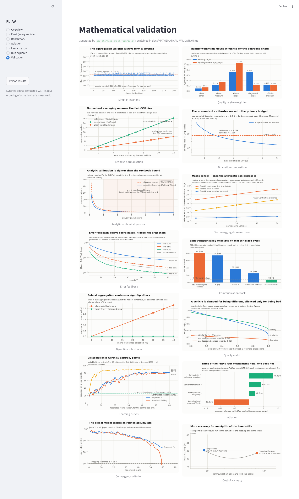

---

## Regenerating these images

```bash
pip install -r requirements.txt playwright pillow

# Steps 1–9: runs every command and renders its output as a PNG (~10 min on 4 cores)
bash scripts/make_run_guide.sh
SKIP_SLOW=1 bash scripts/make_run_guide.sh      # skip benchmark + ablation

# Steps 10–17: browser screenshots of every dashboard page
streamlit run dashboard/app.py &
python -m playwright install chromium            # once, if Playwright has no browser
python scripts/screenshot_dashboard.py           # add --skip-launch to skip Step 15
```

- `scripts/render_terminal.py` turns a captured text file into a terminal-style PNG:
  `python scripts/render_terminal.py out.png "Title" "command" output.txt`.
- `scripts/screenshot_dashboard.py` clicks through the sidebar pages with headless Chromium. If
  Chromium is already installed elsewhere, point to it with `CHROMIUM_PATH=/path/to/chrome`.
- Benchmark and ablation write to `runs/` (git-ignored), so regenerating never touches the
  committed `results/`.
