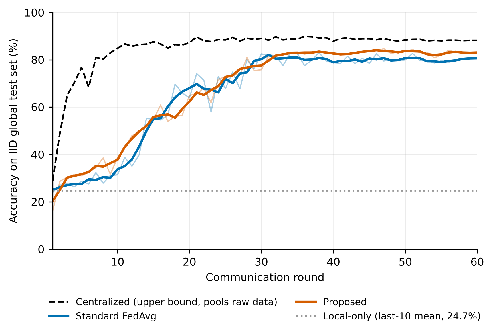
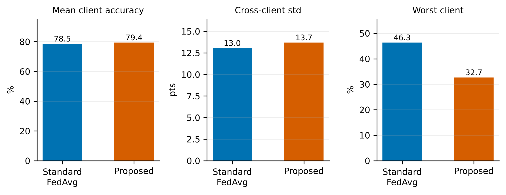

**Abstract.** Connected autonomous vehicles (CAVs) collect perception data that cannot be pooled centrally for reasons of privacy, bandwidth and regulation. We study FL-AV, a federated-learning framework in which a fleet of vehicles jointly trains one multi-task perception model (classification, box localisation and trajectory prediction; 0.70 M parameters) while only model deltas cross the vehicle-to-infrastructure (V2I) link to a road-side unit (RSU). FL-AV combines quality-aware aggregation, connectivity- and trajectory-aware client selection, a compressed transport stack (deltas, float16, gzip, top-$k$ sparsification with error feedback, multicast) and optional secure aggregation and differential privacy. On a simulated 50-vehicle fleet with strongly non-IID data (Dirichlet $\alpha=0.4$) and a single random seed, federation lifts accuracy from 24.7 % (local-only) to 82.9 % (mean of the last ten rounds), 94 % of a centralized upper bound, with no raw sensor sample leaving a vehicle. Relative to an uncompressed, unicast FedAvg baseline the transport stack cuts measured traffic by **88.3 %** (74.6 to 8.7 MB per round); about 82 % of that saving comes from lower precision and multicast rather than from sparsification. A controlled single-mechanism ablation shows that three of four algorithmic mechanisms help but adaptive local epochs *lower* accuracy by 12.2 points through objective inconsistency, so we ship that mechanism disabled. We report failures as plainly as successes: the framework did not converge faster, the worst-served vehicle fell from 46.3 % to 32.7 %, and detection mAP@0.5 stays low (0.10 against 0.54 centralized). Finally, an independent audit of the code performed while preparing this paper found defects that qualify several of the headline comparisons (the "standard FedAvg" baseline uses a link-ranked rather than uniform-random selector, normalised averaging is bypassed on the secure-aggregation path, and the committed arms come from different code revisions). We state exactly which conclusions survive. All results come from one synthetic dataset and one seed and should be read as relative orderings, not absolute performance.

**Keywords:** federated learning; connected autonomous vehicles; communication efficiency; secure aggregation; non-IID data; error feedback; negative results.

# Introduction

A fleet of connected autonomous vehicles (CAVs) sees far more of the world than any single vehicle, and pooling that experience would give every vehicle a better perception model. Pooling is usually impossible. Raw camera and LiDAR streams are large, they contain faces, plates and locations, and the V2I link that carries them is a shared and intermittent resource. Federated learning (FL) [1,2] avoids the transfer: vehicles train on their own data and send only model updates to an aggregator, here a road-side unit (RSU).

Three properties of vehicular fleets make the textbook algorithm, FedAvg [1], a poor fit.

1. **Data are strongly non-IID.** Vehicles in different regions and weather see different class mixtures, different sensor conditions and different amounts of data, and FedAvg degrades under such skew [8,9,10].
2. **Links are scarce and unreliable.** A 0.7 M-parameter model sent in float32 by fifteen vehicles each round costs about 80 MB per round, and rounds are lost when a vehicle leaves coverage.
3. **Not every vehicle is a good teacher.** A minority of vehicles have degraded or mis-calibrated sensors, and equal-weight averaging lets them pull the global model off course.

**What this paper contributes.** None of the individual building blocks we use is new: quality weighting, sparsification with error feedback, normalised averaging and Gaussian-mechanism accounting all have prior art (Section 2). Our contribution is an integrated, fully measured system and an unusually candid evaluation of it:

* **C1. A measured communication result with an honest decomposition.** An integrated transport stack reduces traffic per round from 74.6 MB to 8.7 MB (−88.3 %) relative to an uncompressed unicast baseline, measured from real serialised bytes. We decompose the saving layer by layer, show that most of it comes from float16 and multicast, and report the accuracy cost (0.7 points, confounded with secure aggregation) in a controlled comparison (Sections 5.2 and 5.4).
* **C2. A negative result with a mechanism.** Adaptive local epochs, a plausible and widely suggested idea for heterogeneous on-board compute, reduce accuracy by 12.2 points. We trace the loss to objective inconsistency, show that normalised averaging [6] recovers about half of it, and explain why the other half remains (Section 5.4).
* **C3. A tail analysis.** The framework lifts the fleet average but leaves the worst-served vehicle behind. We show that quality weighting reduces dispersion in isolation (−31 %), show that the regression in the combined system is *not* explained by the mechanism we first suspected, and list the remaining candidate explanations (Section 5.5).
* **C4. Verified mathematics.** The paper's equations are checked numerically against the code that runs. The check exposed a float32 cancellation defect in secure aggregation that unit tests had missed; it is fixed and covered by a regression test (Section 5.7).
* **C5. A code audit.** An independent audit of the implementation and the committed results, run while preparing this paper, found five defects that qualify the headline comparisons. We list them, state what each does and does not invalidate, and give the corrective plan (Section 5.8). Reporting this is, in our view, part of the contribution: a federated-learning evaluation that discloses its own provenance problems is more useful than one that does not.
* **C6. Reproducibility.** One command regenerates every figure in this paper from committed artefacts, and every run records a configuration fingerprint (Appendix D).

**What this paper does not claim.** We do not claim state-of-the-art accuracy on a public benchmark (the data are synthetic), a statistically established ranking of close competitors (one seed), real-radio performance (V2I is simulated), cryptographic security (secure aggregation is simulated), an end-to-end differential-privacy guarantee, or end-to-end results for Byzantine defence (these are verified at the component level only). Section 6 lists these limits explicitly, and Appendix A maps every claim in this paper to the artefact that supports it.

# Related work

**Federated optimisation under heterogeneity.** FedAvg [1] averages local SGD results. FedProx [4] adds a proximal term to limit client drift, SCAFFOLD [5] corrects drift with control variates, and FedOpt [7] applies adaptive optimisers on the server. Hsu et al. [8] study label skew with Dirichlet partitions and show that server momentum helps; Hsieh et al. [9] and Li et al. [10] document how non-IID data degrade accuracy across settings. FedNova [6] shows that when clients take different numbers of local steps, plain averaging optimises a mismatched surrogate objective, and proposes normalised averaging. We adopt the FedNova correction without modification and add evidence on where it does and does not suffice (Section 5.4).

**Communication efficiency.** Konečný et al. [3] introduced structured and sketched updates for FL. Top-$k$ sparsification with memory [12], deep gradient compression [13] and the analysis of error feedback [14] show that dropping small coordinates is safe if the dropped mass is accumulated and re-sent; Sattler et al. [11] combine sparsification with ternarisation for non-IID FL. We use top-$k$ with error feedback as the main lever and add the surrounding engineering (deltas, float16, gzip, RSU multicast, and a closed-loop controller that raises sparsity when a round overruns its byte budget).

**Privacy.** Secure aggregation [15] lets a server learn only the sum of masked client updates; differential privacy [16] bounds what the sum reveals about any one client; Rényi accounting of the subsampled Gaussian mechanism [17,32] and the analytic Gaussian mechanism [18] give tight budgets. Gradient inversion [19] motivates withholding individual updates. We implement these standard components and verify them numerically (Section 5.7).

**Client selection and robustness.** Resource-aware selection [21] and utility-guided selection [22] reduce wasted rounds and speed convergence. Byzantine-robust aggregation [20] bounds the damage of poisoned updates. Our selector combines a link-uptime filter, region stratification and a starvation guard.

**Vehicular FL.** A recent survey [23] reviews FL for connected and automated vehicles and identifies privacy, heterogeneity and communication as open challenges. To our knowledge, evaluations in this setting rarely report negative ablation results or tail-client metrics, which is the gap our evaluation targets.

# Method

## Setting and notation

A fleet of $N$ vehicles holds private shards $D_k$ with $n_k=|D_k|$ and $n=\sum_k n_k$. Each round $r$ the RSU selects a subset $S(r)$ of size $\lceil CN\rceil$. The global objective is

$$\min_w F(w)=\sum_{k=1}^{N}\frac{n_k}{n}F_k(w),\qquad F_k(w)=\frac{1}{n_k}\sum_{i\in D_k}\mathcal L(w;x_i,y_i).$$

Vehicle $k$ runs $E$ epochs of SGD from the broadcast model $w^{(r)}$, producing a delta $\Delta W_k=w_k-w^{(r)}$ after $\tau_k$ local steps. Only $\Delta W_k$, the sample count $n_k$ and a scalar quality $q_k$ are transmitted.

{width=92%}

## Quality-aware aggregation

Standard FedAvg weights vehicle $k$ by $n_k/n$. We instead use

$$\alpha_k=\frac{q_k\,n_k}{\sum_{j\in S(r)}q_j\,n_j},\qquad \sum_k\alpha_k=1,\ \alpha_k\ge 0,$$

so $\alpha$ always lies on the probability simplex (verified to $5.6\times10^{-16}$ over 4,000 random draws, Section 5.7). The quality score is computed on the vehicle from two factors,

$$q_k=\operatorname{clamp}\big(\text{sim}_k\cdot\text{health}_k,\ q_{\min},\ q_{\max}\big),\qquad \text{sim}_k=1-H(p_k,p_{\text{ref}}),$$

where $H(p,q)=\lVert\sqrt p-\sqrt q\rVert_2/\sqrt2\in[0,1]$ is the Hellinger distance between the vehicle's label histogram $p_k$ and a fleet reference histogram, and $\text{health}_k$ is an on-board sensor-health score built from blur, occlusion, rain intensity and a calibration flag, never from labels. A floor $q_{\min}=0.05$ keeps a rare but clean region contributing, so that a vehicle is strongly damped only when it is both off-distribution and degraded. The fleet reference histogram is the one piece of fleet-level statistics the scheme needs; it is far less revealing than raw data but not free, and in deployment it should be gathered under secure aggregation.

## Normalised averaging for unequal local work

When local step counts $\tau_k$ differ, a plain weighted mean of deltas over-weights vehicles that took more steps and converges to the wrong point. We use the FedNova-style normalised aggregate [6]

$$\Delta=\Big(\sum_k\alpha_k\tau_k\Big)\sum_k\alpha_k\frac{\Delta W_k}{\tau_k},$$

which is inert when all $\tau_k$ are equal and matches the reference value exactly when they are not (Appendix C, Figure C1). **Caveat found by our audit (Section 5.8):** with quantity skew the step counts differ across vehicles even when the epoch count is fixed, so this correction is not a corner case; yet in the shipped configuration, where secure aggregation is on by default, the aggregator computes the normalised mean and then overwrites it with the raw weighted mean from the secure-sum path. The headline "proposed" arm therefore contains *no* normalisation effect; the correction was exercised only in the non-secure ablation runs.

## Server momentum

The server smooths the aggregate with momentum $\beta$:
$v\leftarrow\beta v+\Delta$, applied step $=(1-\beta)v+\beta\Delta$, $w^{(r+1)}=w^{(r)}+\text{step}$.
The convex blend makes the first round identical to plain FedAvg (regression-tested) and lets later rounds inherit a smoothed direction [8].

## Connectivity- and trajectory-aware selection

The selector picks $S=\lceil CN\rceil$ vehicles in four steps. (i) *Connectivity filter:* vehicles whose predicted link uptime (long-run uptime plus round-to-round jitter) is below a threshold (0.55) are ineligible; if too few remain, the threshold is relaxed geometrically rather than returning an empty round. (ii) *Starvation promotion:* among the eligible vehicles, any vehicle unselected for more than $K=12$ rounds is moved to the front of the queue. (iii) *Region stratification:* remaining slots are filled round-robin over regions, taking the highest-scoring vehicle of each region. (iv) *Score fill:* any remaining slots go to the highest-scoring vehicles. The score is a deterministic ranking, $0.55\,\text{uptime}+0.25\,\text{sensor quality}+0.10\,\log(1+n_k)/10+0.10/(1+\text{times selected})$, so selection is neither random nor independent of the data. The intent is that rounds are not lost to dropped uplinks, that every region is still represented, and that no vehicle starves. **Caveat found by our audit (Section 5.8):** the starvation guard only considers vehicles that pass the connectivity filter, so it does not bound the gap between selections of low-uptime vehicles.

## Transport stack

Each uplink passes through four stages. (a) The vehicle sends the *delta* rather than weights, which sparsifies and compresses better. (b) **Top-$k$ with error feedback** [12,14] transmits the $k$ largest-magnitude coordinates and keeps the remainder in an on-vehicle residual:

$$d_k^{r}=\Delta W_k^{r}+e_k^{r-1},\qquad s_k^{r}=\operatorname{top}_k(d_k^{r}),\qquad e_k^{r}=d_k^{r}-s_k^{r}.$$

No coordinate is discarded, only delayed, and the residual never leaves the vehicle, so the privacy property is untouched. (c) The sparse delta is serialised in float16 and gzip-compressed (runs of zeros cost almost nothing, so no sparse index format is needed) with a CRC32 integrity check. (d) The global model is multicast once into the RSU's cell instead of unicast to each vehicle. A closed-loop bandwidth controller raises the sparsity when a round overruns the per-round budget (9 MB) and relaxes it when there is headroom. The cost is $C_{\text{total}}=\sum_{r}\sum_{k\in S(r)}(C^{\uparrow}+C^{\downarrow})$, measured from actual serialised byte counts including TLS record overhead and billing for uplinks that were dropped, not estimated from parameter counts. TLS handshake bytes are not counted.

## Privacy mechanisms

**Secure aggregation (simulated).** Every pair $(i,j)$ of participants derives a shared seed and expands it into a mask $m_{ij}$; vehicle $i$ adds $+m_{ij}$ if $j>i$ and $-m_{ij}$ if $j<i$. The masks cancel in the sum, so $\sum_k(\alpha_k\Delta W_k+\text{mask}_k)=\sum_k\alpha_k\Delta W_k$, and the runner checks this identity every round. This reproduces the *arithmetic* of the Bonawitz-style protocol [15], not its security: in this simulation the masks are real-valued, seeded from the public configuration seed, with no key exchange, no dropout recovery and a plaintext reference computed on the server for verification. Individual update norms are also revealed to set the mask scale. We therefore treat it as a functional model of the protocol, not as a privacy mechanism.

**Differential privacy (optional).** Each delta is clipped, $\Delta W\leftarrow\Delta W\min(1,C_{\text{clip}}/\lVert\Delta W\rVert_2)$, and Gaussian noise $\mathcal N(0,\sigma^2 I)$ with $\sigma=zC_{\text{clip}}$ is added. The noise multiplier $z$ is calibrated by a Rényi-DP accountant for the subsampled Gaussian mechanism [17] composed over $R$ rounds, found by binary search so that the $R$-fold composition stays within the target $(\varepsilon,\delta)$. Under secure aggregation each vehicle adds only $\sigma/\sqrt{|S|}$ noise, so the independent draws sum to $\mathcal N(0,\sigma^2)$ in the aggregate. **This accounting is not an end-to-end guarantee:** the accountant assumes Poisson sampling at rate $C$ independent of the data, whereas selection here is deterministic and depends on link, quality and region; the noise is split over the selected rather than the reporting vehicles; and the aggregation weights $\alpha_k$, which depend on data-dependent $n_k$ and $q_k$, are themselves released. No DP-enabled training run is committed.

**Robust aggregation (optional).** Updates whose norm exceeds three times the median are rejected and the rest are combined with a coordinate-wise weighted trimmed mean. This is mutually exclusive with secure aggregation by construction, because a trimmed mean needs per-client values that secure aggregation hides.

## Algorithm

```
Input: fleet of N vehicles, fraction C, rounds R, local epochs E, momentum beta
RSU initialises w, v <- 0
for r = 1..R:
    S <- Select(C, uptime, regions, fairness_K)               # (1)
    multicast w to S
    for each vehicle k in S in parallel:
        w_k <- LocalSGD(w, D_k, E);  dW_k <- w_k - w          # (2)
        q_k <- sim_k * health_k   (computed on-vehicle)
        d_k <- dW_k + e_k;  s_k <- topk(d_k);  e_k <- d_k - s_k
        send Mask(Compress(s_k)), n_k, q_k                    # (3)
    alpha_k <- q_k n_k / sum_j q_j n_j
    Delta <- (sum alpha_k tau_k) * sum alpha_k (s_k / tau_k)  # (4) via secure sum
    v <- beta v + Delta;  w <- w + (1-beta) v + beta Delta
    stop if ||w_new - w_old|| <= eps
```

# Experimental protocol

## Data and fleet

Real driving datasets such as KITTI [27] and nuScenes [28] cannot be redistributed, and CARLA [26] needs a GPU simulator. We therefore use a CARLA-style procedural generator that reproduces the *structure* of the problem rather than the appearance statistics of real sensors. Every cue that a label depends on is drawn into the 32×32 image: object shape, aspect ratio and colour determine the class (six classes); the rendered rectangle is the box; motion-streak length and direction plus lane-marking slant encode the six-waypoint future trajectory. The fleet has $N=50$ vehicles with three combined skew axes:

* **Label skew:** $p_k\sim\mathrm{Dirichlet}(\alpha\mathbf 1)$ with $\alpha=0.4$.
* **Feature skew:** region (urban, highway, rural) × weather (clear, rain, fog, night) changes brightness, contrast, blur, noise, fog blend, rain streaks and occlusion.
* **Quantity skew:** $n_k$ log-normal with $\sigma=0.45$ around 220 samples; about 7,700 training samples in total.

About 12 % of vehicles are *de-calibrated* (extra blur, brightness drift, 25–45 % label corruption), which are precisely the vehicles $q_k$ is meant to discount. Each vehicle's data are split 70/15/15 into train/validation/test. All arms are additionally scored on one **IID global test set** of 1,800 samples spanning every region × weather combination.

## Model

A MobileNetV3-style multi-task network [24] with 700,485 parameters: stem convolution, three stages of inverted residual blocks with squeeze-and-excitation, a $1\times1$ neck producing a $4\times4$ feature grid, and heads for classification (6 classes), box size, trajectory (6 waypoints) and a centre heat-map whose softmax-weighted soft-argmax yields $(c_x,c_y)$. We use **GroupNorm** [25] throughout, never BatchNorm, because batch statistics are client-specific under non-IID data and averaging them is a classic source of FedAvg divergence; every tensor in the state dict is therefore safe to average. The loss is $\mathrm{CE}+\lambda_{\text{box}}[2\,\mathrm{SmoothL1}(\text{centre})+\mathrm{SmoothL1}(\text{size})]+\lambda_{\text{traj}}\mathrm{SmoothL1}(\text{traj})$ with the box and trajectory terms masked on background samples.

## Arms

All arms share one fleet and one seed (1337).

* **Centralized** pools all raw data (an upper bound that violates the privacy constraint).
* **Local-only** trains each vehicle on its own shard with no communication (a lower bound).
* **Standard FedAvg** uses $n_k/n$ weights, no momentum, fp32 full-weight transfer over unicast links with gzip, and the *same score-ranked selector* with the uptime filter, region stratification and starvation guard switched off. It is **not** uniform-random selection, although the project's documentation describes it as such (Section 5.8).
* **Proposed** uses quality-aware weights, connectivity/trajectory-aware selection, server momentum, the full transport stack and secure aggregation. Adaptive local epochs are **off** (Section 5.4). Normalised averaging is nominally on but bypassed on the secure-aggregation path (Sections 3.3 and 5.8).

Common settings: $C=0.3$ (15 vehicles per round), $E=5$, $R_{\max}=60$, learning rate 0.01 with cosine decay, SGD momentum 0.9, batch size 32. Appendix B lists all hyperparameters.

## Metrics

*Accuracy* is top-1 classification accuracy on the global test set. *mAP@0.5* counts a detection as true positive when the class matches and the box IoU is at least 0.5, with all-point interpolated average precision averaged over foreground classes. *ADE/FDE* are average and final displacement error of the predicted trajectory (lower is better). *Non-IID robustness* is the standard deviation, minimum and decile of accuracy measured on each vehicle's local test split. *Communication* is measured from serialised bytes. A run's "best round" is the maximum over rounds *on the global test set*, which is optimistic because the checkpoint is selected on the data it is scored on; the per-vehicle validation splits are not used for this. We therefore treat the **mean of the last ten rounds** as the primary accuracy metric and report the best round only for continuity with the project's documentation.

# Results

All numbers below are read from the committed artefacts in `results/` and regenerated by `paper/make_paper_figures.py`. Unless stated otherwise they come from a single seed.

## Collaboration is worth most of the centralized ceiling

: **Table 1.** Main benchmark (N = 50, C = 0.3, E = 5, R = 60, α = 0.4, seed 1337). Lower is better for ADE and communication.

| Metric | Centralized | Local-only | Std. FedAvg | Proposed |
|---|---:|---:|---:|---:|
| **Accuracy, last-10 mean (%) (primary)** | 88.21 | 24.70 | 80.09 | **82.94** |
| Accuracy, best round (%) (selected on test set) | 89.89 | 25.19 | 83.00 | 84.67 |
| mAP@0.5 | 0.5443 | 0.0050 | 0.0892 | **0.1004** |
| Trajectory ADE | 0.1877 | 0.3234 | **0.1966** | 0.2017 |
| Communication (MB/round) | 0 | 0 | 74.56 | **8.72** |
| Total communication (MB) | 90.2 (raw data) | 0 | 4,473.7 | **523.3** |
| Cross-client accuracy std | 0.126 | 0.069 | **0.130** | 0.137 |
| Worst-client accuracy | 0.509 | 0.169 | **0.463** | 0.327 |
| Raw data leave vehicles | yes | no | no | no |

Federation is worth 58 accuracy points over local-only training on the primary metric (last-10 mean 82.94 against 24.70; 59.5 points on the best-round metric). The proposed arm recovers 94.0 % of the centralized ceiling (82.94 / 88.21; 94.2 % on best rounds) without any raw sensor sample leaving a vehicle (Figure 2). Vehicles training alone cannot learn the 6-class problem from skewed shards of about 150 samples.

{width=80%}

## Communication: 88.3 % less traffic

The proposed stack transmits 8.72 MB per round against 74.56 MB for standard FedAvg, a total of 523 MB against 4,474 MB over 60 rounds (−88.3 %; Figure 3). The budget constraint of 9 MB/round is met. In isolation, on the same 700,485-parameter model and 15 vehicles, each layer of the stack contributes as follows: raw float32 unicast 80.2 MB; with gzip 74.3 MB; with float16 37.1 MB; with top-25 % sparsity 25.2 MB; with RSU multicast 8.0 MB (−90.1 % cumulative; Appendix C, Figure C2). The measured in-training figure of 8.72 MB is slightly higher than the isolated 8.0 MB because it includes TLS record overhead and bills uplinks that were dropped.

{width=95%}

**Where the saving comes from.** Of the 66.4 MB per round saved beyond the gzip stage, float16 accounts for 56 % (37.3 MB), RSU multicast for 26 % (17.3 MB) and top-$k$ sparsification with error feedback for only 18 % (11.8 MB), because zeroed coordinates are gzip-coded rather than index-coded. About 82 % of the saving therefore comes from engineering choices (precision and multicast) that any FedAvg deployment could adopt, not from the algorithmic component. **We did not run a FedAvg baseline with the same transport stack**, so the saving relative to a transport-matched baseline is untested and would be smaller; the headline figure is accurate for the stated baseline (fp32, full weights, unicast, gzip) and should be quoted with it.

**Accuracy cost.** In a controlled comparison on identical algorithmic settings at $R=30$ (all algorithmic mechanisms, adaptive epochs on, plain mean), adding compression *and* secure aggregation changed accuracy from 61.6 % to 60.9 % (−0.7 points) while reducing traffic from 74.55 to 8.68 MB per round. The two changes were introduced together, so their effects are confounded, and at one seed the difference is within run-to-run noise (Section 6.1); we therefore state it as "no measurable loss" rather than as a gain.

## Convergence speed: no improvement

: **Table 2.** First round at which the global accuracy reaches a threshold (lower is faster).

| Threshold | Centralized | Std. FedAvg | Proposed |
|---|---:|---:|---:|
| 50 % | 3 | 14 | 14 |
| 60 % | 3 | 18 | **16** |
| 70 % | 4 | **21** | 24 |
| 75 % | 5 | 28 | 28 |
| 80 % | 7 | 28 | 28 |
| 83 % | 10 | 38 | **34** |

The proposed arm is faster to 60 % and 83 %, slower to 70 %, and tied elsewhere. The requirement that the framework cut rounds-to-target by at least 25 % is **not met** (Section 5.6). In the final 20 rounds the proposed arm averages $83.1\pm0.9\,\%$ and standard FedAvg $80.0\pm1.3\,\%$ (mean $\pm$ standard deviation across rounds), and the proposed arm is higher in 28 of the last 30 rounds. These are descriptive statistics of one trajectory, not independent samples: rounds are strongly autocorrelated, so they do *not* constitute a significance test.

## Single-mechanism ablation, including a harmful mechanism

Each mechanism was run in isolation against a FedAvg control at $R=30$ on the same fleet and seed, with the transport stack held constant (Figure 4, Table 3). Two caveats apply throughout: the control uses the same score-ranked selector as the standard-FedAvg arm (so the selection effect is measured against a link-ranked, not a random, baseline), and the code revision that produced each ablation arm is not recorded in its summary, so arms may straddle the commit that introduced normalised averaging (Section 5.8).

{width=97%}

: **Table 3.** Ablation at $R=30$ (one seed). "Std" is the cross-client accuracy standard deviation; "Min" is the worst vehicle.

| Arm | Accuracy (%) | Δ vs control | Std | Min | MB/round |
|---|---:|---:|---:|---:|---:|
| FedAvg control | 70.78 | — | 0.154 | 0.224 | 74.55 |
| + Connectivity/trajectory selection | 79.00 | **+8.2** | 0.124 | 0.429 | 74.56 |
| + Server momentum | 75.00 | +4.2 | 0.157 | 0.245 | 74.56 |
| + Quality-aware weighting | 72.78 | +2.0 | **0.106** | 0.388 | 74.56 |
| + Adaptive local epochs (plain mean) | 58.61 | **−12.2** | 0.193 | 0.122 | 74.56 |
| + Adaptive epochs, normalised averaging | 64.56 | −6.2 | 0.141 | 0.224 | 74.55 |
| All algorithmic, adaptive epochs on (plain) | 61.61 | −9.2 | 0.155 | 0.286 | 74.55 |
| All algorithmic, adaptive epochs on (normalised) | 68.17 | −2.6 | 0.164 | 0.327 | 74.56 |
| Previous row + compression + secure aggregation | 60.89 | −0.7 vs plain row above | 0.165 | 0.245 | **8.68** |

Three observations follow.

**Selection, momentum and quality weighting each help.** Quality-aware weighting reduces the cross-client standard deviation by 31 %, exactly the non-IID robustness it is designed to provide, and is the clearest confirmation of a design hypothesis in this study. The +8.2 points for selection is the largest single gain but, as noted, is relative to a link-ranked control and mixes three components (connectivity filter, region stratification, starvation guard) that were not separated.

**Adaptive local epochs are harmful, and we know why.** Scaling the epoch count to on-board compute makes $\tau_k$ differ across vehicles. A vehicle that ran eight epochs contributes a longer vector than one that ran one, and a plain weighted mean over-weights the fast vehicles regardless of $\alpha_k$, so the aggregate converges to the wrong point (Appendix C, Figure C1 shows the bias growing linearly with the step-count ratio). Normalised averaging removes that bias and recovers about half of the loss (−12.2 to −6.2 alone; −9.2 to −2.6 combined). The remaining deficit is real: heterogeneous $\tau_k$ costs something beyond objective inconsistency at this scale, and we have not isolated what. We therefore keep the mechanism fully implemented and tested but **disabled by default**. This is the one place the implementation knowingly departs from its own requirements document, and the evidence for the departure is committed. (The project's documentation says normalised averaging stays on whenever $E_k$ varies; our audit shows that this does not hold on the secure-aggregation path, Section 5.8.)

**The gains do not add.** The three helpful mechanisms (+8.2, +4.2, +2.0 in isolation) combine to only +1.7 points in the 60-round benchmark (84.67 against 83.00), so they overlap or interfere. The two experiments also differ in horizon (30 against 60 rounds), so the numbers are not directly comparable. We did not run the ablation grid at $R=60$ and consider the interaction structure an open question.

## The tail: the mean improves, the worst vehicle does not

The proposed arm raises mean per-vehicle accuracy slightly (79.4 % against 78.5 %) but has higher dispersion (0.137 against 0.130) and a lower worst-vehicle accuracy (32.7 % against 46.3 %, a gap of 13.6 points; Figure 5, Table 1). In isolation quality weighting *reduces* dispersion by 31 %, so something in the combined system reverses its effect. The project's documentation attributes this to connectivity-aware selection seeing poorly connected vehicles less often. **Our selector audit contradicts that explanation:** in a selector-only simulation with the committed seed and fleet, the proposed selector chose the six vehicles with uptime below 0.55 on average 3.5 times in 60 rounds, whereas the standard-FedAvg selector chose them 1.7 times, and uniform sampling would choose each vehicle 18 times. Both arms under-sample poorly connected vehicles, and the proposed arm does so *less*. The remaining candidate explanations are untested: quality weighting discounting the de-calibrated vehicles that happen to be scored in the tail, server momentum, the absence of normalised averaging on the secure path, and the small, noisy local test splits (next paragraph). We therefore report the regression as an observed fact whose cause is unresolved. For a safety-relevant system the tail is arguably more important than the mean.

{width=88%}

**Caution on the worst-vehicle statistic.** Each vehicle's local test split is small (the worst vehicles in this study were scored on 41 to 49 samples), so one vehicle's accuracy has a binomial standard error of about 7 points. The 13.6-point gap in the *minimum* between two arms is therefore about two standard errors of a single vehicle's estimate, and the minimum is the extreme of 50 such noisy values. We report it because it is the most unfavourable number for our method and because the direction agrees with the dispersion statistics, not because its magnitude is precisely established.

## Audit against the project's stated requirements

The project's requirements document defines eight acceptance criteria. Table 4 reports all of them, including the five that fail.

: **Table 4.** Acceptance audit.

| Criterion | Requirement | Observed | Result |
|---|---|---|:---:|
| Accuracy target | accuracy ≥ 90 % | 84.67 % | Fail |
| Convergence speed-up | ≥ 25 % fewer rounds to target than FedAvg | not reached by either arm | Fail |
| Communication saving | ≥ 30 % less MB/round than FedAvg | −88.3 % | **Pass** |
| Communication budget | ≤ 9.0 MB/round | 8.72 | **Pass** |
| Non-IID robustness | dispersion ≤ FedAvg | 0.137 vs 0.130 | Fail |
| Relative convergence | ≥ 25 % fewer rounds to 95 % of centralized | not reached by either arm | Fail |
| Accuracy vs ceiling | ≥ 95 % of centralized | 94.2 % | Fail |
| Privacy | no raw data egress | none | **Pass** |

The 90 % absolute target is a scale artefact: the centralized upper bound on this data is 89.9 %, so no federated arm could clear it. The requirement was calibrated to a larger data volume than the generator produces. We report it as failed rather than re-defining it.

## Verification of the mathematics

Every equation above was checked numerically against the shipped implementation (`scripts/make_proof_figures.py`, 14 figures, results in `docs/figures/residuals.json`). Highlights:

* **Simplex invariant.** Maximum deviation of $\sum_k\alpha_k$ from 1 over 4,000 draws: $5.6\times10^{-16}$ (machine epsilon $2.2\times10^{-16}$).
* **Quality weighting.** On a five-vehicle example the degraded large shard's aggregation share drops from 35.7 % to 11.2 %.
* **Normalised averaging.** Maximum error against the reference over $\tau\in[1,12]$ is 0 for normalised averaging against 8.25 for the plain mean.
* **Privacy accounting (accountant output only).** For $q=0.3$, 60 rounds and $\delta=10^{-5}$ the calibrated noise multiplier $z=1.748$ yields $\varepsilon=7.996$, inside the budget of 8, *under the accountant's own assumptions*. As explained in Section 3.7, those assumptions do not hold for this selector, so this is not an end-to-end guarantee.
* **Error feedback.** Relative error at round 60 is 6.8 %, 2.2 % and 0.9 % for keep-ratios 0.1, 0.25 and 0.5, and the residual stays inside its theoretical bound $((1-\delta)/\delta)\lVert u\rVert$.
* **Byzantine robustness (component level).** Against six sign-flipping clients out of 20, the plain mean's maximum error is 2.8 and the norm filter plus trimmed mean's is 0.

**A defect found by verification.** The verification showed that secure aggregation's masks did *not* cancel adequately in the first implementation. With float32 accumulation and mask scale 1.0 the relative error of the recovered sum was 0.18 at 64 participants, above the runner's tolerance of $10^{-3}$ from only eight participants: each client sums its pair masks in a different order and float32 addition is not associative. The shipped path uses float64 accumulation and masks scaled to the update, which brings the error to $1.3\times10^{-7}$ at 64 participants while every individual masked update remains buried under a mask at least 57 times its own magnitude in this simulation (Appendix C, Figure C3). The masks are not cryptographically generated (Section 3.7), so this shows arithmetic exactness, not security. The defect is fixed and covered by a regression test. We mention it because unit tests at small participant counts had passed.

## Code audit and provenance

While preparing this paper we audited the implementation and the committed artefacts independently of the project's own documentation, including by running the code. The suite of 51 tests passes (35 s on CPU). The audit nevertheless found the following, which qualify the results above. We list them in descending order of consequence; none was visible from the tests or from the original documentation.

: **Table 5.** Audit findings and their consequences.

| # | Finding | Consequence for this paper |
|---|---|---|
| 1 | **Mixed code revisions.** The committed standard-FedAvg arm was produced before normalised averaging existed (its configuration lacks that key; at the current revision it would have a different configuration fingerprint, `bf38429e1cff` against the committed `6ce7acb93704`). The proposed arm was rerun twice. | The arms in Table 1 were not generated by one code revision. Differences are therefore not strictly attributable to the method. |
| 2 | **Normalised averaging is bypassed on the secure-aggregation path**, which is on by default and in the proposed arm. A one-round test gave a relative difference of exactly 0.0 between normalisation on and off with secure aggregation on, against 4.6 % on the non-secure path. | The proposed arm in Table 1 contains no normalisation effect, the R = 30 "fix" evidence cannot be transferred to the shipped configuration, and the documentation's statement that normalisation stays on is false for the default path. |
| 3 | **The "standard FedAvg" baseline is not random.** It uses the same score-ranked selector (55 % weight on link uptime) with the filter, stratification and guard disabled. Its selection Gini is 0.538, against about 0.11 for uniform random. | Both arms and the ablation control are link-biased. The selection effect (+8.2) is measured against that control; the documentation's explanation of the tail regression is contradicted (Section 5.5). |
| 4 | **The starvation guard does not give its documented bound.** It only considers vehicles above the uptime threshold. In the committed seed, 28 of 50 vehicles waited more than $K=12$ rounds and the longest gap was 38 rounds. | The claim "no vehicle starves" is not supported. A test passes only because it sets the threshold to zero. |
| 5 | **Test-set selection.** Best round, best checkpoint and rounds-to-target are chosen on the global test set; the per-vehicle validation splits are unused. | Best-round numbers are optimistic. We use last-10-round means as the primary metric. |
| 6 | **Transport attribution.** There is no FedAvg baseline with the same transport; fp16 and multicast account for about 82 % of the saving. The bandwidth controller and straggler timeout never fired in the committed runs. | The 88.3 % figure is valid only against the stated baseline (Section 5.2). The controller is described but unexercised. |
| 7 | **Privacy claims.** Secure aggregation is a functional simulation with public-seed masks; the DP accountant's assumptions do not match the selector; no DP training run exists. | We make no claim of cryptographic security or end-to-end DP (Sections 3.7 and 5.7). |
| 8 | **Metrics.** The "mAP@0.5" is a single-object-per-image proxy; ADE/FDE are in normalised synthetic units; the local-only dispersion is computed on a different test set than the federated arms. | Detection and trajectory numbers are comparable between arms only, not with external benchmarks; local-only dispersion in Table 1 is not comparable. |

**What survives.** Findings 1 to 5 qualify the *comparison of the proposed arm against FedAvg* (the +1.7 to +2.9-point difference, the dispersion and tail numbers, and the selection effect). They do not affect: the large federation effect over local-only and the 94 % ceiling recovery (both arms were produced by the same pipeline and the effect is more than 50 points); the mechanism and magnitude of the adaptive-epoch harm, which rests on a closed-form micro-benchmark as well as on an ablation; the numerical verification of the equations; and the byte-exact traffic accounting for the stated baseline. **What does not survive:** any claim that the proposed arm is better than FedAvg on mean accuracy, that selection caused a specific gain, that no vehicle starves, that normalised averaging was active in the headline run, or that the system provides cryptographic or end-to-end differential privacy.

**Corrective plan.** (a) Regenerate every arm from a single revision with the defects fixed: apply normalisation on the secure path, use a genuine uniform-random baseline selector, and apply the starvation guard to all vehicles. (b) Add a FedAvg baseline with the same transport stack. (c) Select checkpoints on per-vehicle validation data, not the test set. (d) Run at least ten seeds and report bootstrap confidence intervals [31]. (e) Add at least one standard federated baseline beyond FedAvg (for example FedProx [4] and SCAFFOLD [5]). We have not yet done this, so the present paper should be read as a verified account of what the evidence does and does not show rather than as a final evaluation.

# Discussion

**What the evidence supports.** (i) Federation recovers most of the value of pooling, and the large effect (+58 points over local-only) cannot plausibly be a seed artefact. (ii) Against an uncompressed unicast baseline the transport stack removes almost nine tenths of the traffic with no measurable accuracy cost, and the traffic number is robust because it depends on byte counts, not on training noise; its attribution, however, is mostly to precision and multicast. (iii) Adaptive local epochs with plain averaging are harmful, and the mechanism for the harm is identified and independently verified in a closed-form micro-benchmark. These three findings are large relative to any plausible noise.

**What the evidence does not support.** The +1.7 to +2.9-point accuracy advantage over FedAvg and the ordering of the three mildly helpful mechanisms lie within what one seed can plausibly produce, are qualified by the audit findings, and are not claimed as established. Nor do we claim faster convergence, better tail behaviour or better localisation.

**Why mAP stays low.** All federated arms reach mAP@0.5 of only 0.09 to 0.10 against 0.54 for the centralized arm, although classification accuracy is close. Localisation is the first capability that non-IID averaging degrades, probably because box regression depends on spatial features that differ by region and weather and are not aligned across vehicles. This is the most informative gap for future work and the strongest argument against presenting the system as ready for deployment.

**Why the tail suffers.** We do not know. Section 5.5 rules out the explanation we first suspected and lists the untested candidates. Tail-aware objectives, such as group-robust weighting or a floor on the selection probability of low-link vehicles, are natural remedies but are untested here and would first require the starvation guard to work as documented.

## Threats to validity and limitations

1. **One seed and one fleet.** All comparisons share one random seed and one fleet draw. Differences of one to three points cannot be ranked. The large effects named above are robust; the small ones are not. Multi-seed replication with confidence intervals (for example, interquartile-mean bootstrap intervals [31]), from a single code revision, is the single most valuable next step.
2. **Synthetic data.** The generator reproduces the structure of the problem, not the appearance statistics of real sensors, so absolute accuracies are not comparable with published results on KITTI or nuScenes; the relative ordering of arms is what is measured. A data adapter documents the swap-in point for real datasets.
3. **Small scale.** About 7,700 training samples, 32×32 images and a 0.7 M-parameter model. Communication saving in megabytes depends on model and fleet size; the percentage reduction is the transferable quantity.
4. **Simulated V2I.** Bandwidth, latency and drops are parametric, not measured on a real radio stack.
5. **Components verified, not end-to-end evaluated.** Differential privacy is verified only at the accountant level, under assumptions the implementation does not meet, and the committed results contain no DP-enabled training run, so we make no claim about its guarantee or accuracy cost. The Byzantine defence is verified in a micro-benchmark, not in a full training run. Only FedAvg is used as a federated baseline; FedProx, SCAFFOLD and server-optimiser baselines are absent.
6. **Simulated secure aggregation.** The masks are not cryptographically generated, there is no dropout recovery, and the scheme cannot be combined with trimmed-mean robustness; reconciling these is future work.
7. **Averages are not tails.** See Section 5.5.
8. **The reference histogram.** The similarity score needs a fleet reference histogram, a small but non-zero leakage that should be collected under secure aggregation in deployment.
9. **Simulation only.** This is not an on-vehicle deployment, and no safety claim follows from these results.

## Ethics, safety and broader impact

The study uses no human subjects, no real vehicle data and no personal information. Federated training reduces the need to move raw sensor data, which is a privacy benefit, but it is not a privacy guarantee on its own: model deltas can leak information [19], which is why secure aggregation and differential privacy are provided. We do not describe any configuration as private in the formal sense: secure aggregation is simulated, and the differential-privacy accounting does not meet its own assumptions (Sections 3.7 and 5.8). Perception models for autonomous driving are safety-critical; the tail behaviour reported in Section 5.5 means that average accuracy must never be used as evidence of safety, and any real deployment would require validation far beyond this simulation. The synthetic data could in principle encode biases (for example, weather and region mixes) that differ from real fleets.

# Conclusion

We built and measured a federated learning framework for collaborative autonomous-vehicle perception. Relative to an uncompressed baseline its transport stack removed 88.3 % of the traffic, mostly through precision and multicast, with no measurable accuracy loss; federation recovered 94 % of the centralized accuracy ceiling without sharing raw data; and a controlled ablation identified one plausible mechanism, adaptive local epochs, as clearly harmful and explained why. The framework did not accelerate convergence, did not improve the worst-served vehicle, and leaves detection quality far below the centralized bound. All evidence comes from one seed of a synthetic benchmark. An audit of our own code and artefacts found defects that qualify the comparison against FedAvg; we list them with their consequences and a corrective plan. We offer the results as a candid baseline and a catalogue of what worked, what did not and what remains unverified, together with the code, configurations and committed artefacts to replicate or refute them.

# Declarations {-}

**Reproducibility.** The repository contains the framework (`fedav/`), configurations (`configs/`), a test suite (51 tests, all passing in our independent run), committed per-round telemetry and summaries for every reported arm (`results/`), the 14 verification figures (`docs/figures/`) and the script that regenerates every figure in this paper (`paper/make_paper_figures.py`). Every run writes its full configuration with a fingerprint hash (the proposed arm: `47d140ca4677`). As Section 5.8 explains, the committed arms were not all produced by one code revision, so re-running the benchmark at the current revision would not reproduce the committed standard-FedAvg arm exactly. Appendix D gives the commands.

**Data and code availability.** Data are generated by the included procedural generator from the seed in the configuration; no external dataset is used. [Authors to state the repository URL, licence and archival DOI at submission.]

**Competing interests.** [Authors to complete. If a patent application covering any part of this work is planned, pending or issued, it must be declared here and on the journal's competing-interests form.]

**Funding.** [Authors to complete.]

**Author contributions.** [Authors to complete, for example with the CRediT taxonomy.]

**Use of AI assistance.** [Authors to describe any AI-assisted drafting, coding or figure generation in the manner required by the target venue.]

# References {-}

*(These references were compiled from memory of the literature in an environment without access to publisher sites; every entry must be checked against the original before submission.)*

1. H. B. McMahan, E. Moore, D. Ramage, S. Hampson, B. A. y Arcas. Communication-efficient learning of deep networks from decentralized data. *AISTATS*, 2017.
2. P. Kairouz et al. Advances and open problems in federated learning. *Foundations and Trends in Machine Learning* 14(1–2), 2021.
3. J. Konečný, H. B. McMahan, F. X. Yu, P. Richtárik, A. T. Suresh, D. Bacon. Federated learning: strategies for improving communication efficiency. arXiv:1610.05492, 2016.
4. T. Li, A. K. Sahu, M. Zaheer, M. Sanjabi, A. Talwalkar, V. Smith. Federated optimization in heterogeneous networks. *MLSys*, 2020.
5. S. P. Karimireddy, S. Kale, M. Mohri, S. Reddi, S. Stich, A. T. Suresh. SCAFFOLD: stochastic controlled averaging for federated learning. *ICML*, 2020.
6. J. Wang, Q. Liu, H. Liang, G. Joshi, H. V. Poor. Tackling the objective inconsistency problem in heterogeneous federated optimization. *NeurIPS*, 2020.
7. S. Reddi et al. Adaptive federated optimization. *ICLR*, 2021.
8. T.-M. H. Hsu, H. Qi, M. Brown. Measuring the effects of non-identical data distribution for federated visual classification. arXiv:1909.06335, 2019.
9. K. Hsieh, A. Phanishayee, O. Mutlu, P. Gibbons. The non-IID data quagmire of decentralized machine learning. *ICML*, 2020.
10. Q. Li, Y. Diao, Q. Chen, B. He. Federated learning on non-IID data silos: an experimental study. *ICDE*, 2022.
11. F. Sattler, S. Wiedemann, K.-R. Müller, W. Samek. Robust and communication-efficient federated learning from non-i.i.d. data. *IEEE Trans. Neural Networks and Learning Systems* 31(9), 2020.
12. S. U. Stich, J.-B. Cordonnier, M. Jaggi. Sparsified SGD with memory. *NeurIPS*, 2018.
13. Y. Lin, S. Han, H. Mao, Y. Wang, W. J. Dally. Deep gradient compression: reducing the communication bandwidth for distributed training. *ICLR*, 2018.
14. S. P. Karimireddy, Q. Rebjock, S. Stich, M. Jaggi. Error feedback fixes SignSGD and other gradient compression schemes. *ICML*, 2019.
15. K. Bonawitz et al. Practical secure aggregation for privacy-preserving machine learning. *ACM CCS*, 2017.
16. M. Abadi et al. Deep learning with differential privacy. *ACM CCS*, 2016.
17. I. Mironov, K. Talwar, L. Zhang. Rényi differential privacy of the sampled Gaussian mechanism. arXiv:1908.10530, 2019.
18. B. Balle, Y.-X. Wang. Improving the Gaussian mechanism for differential privacy: analytical calibration and optimal denoising. *ICML*, 2018.
19. L. Zhu, Z. Liu, S. Han. Deep leakage from gradients. *NeurIPS*, 2019.
20. D. Yin, Y. Chen, K. Ramchandran, P. Bartlett. Byzantine-robust distributed learning: towards optimal statistical rates. *ICML*, 2018.
21. T. Nishio, R. Yonetani. Client selection for federated learning with heterogeneous resources in mobile edge. *IEEE ICC*, 2019.
22. F. Lai, X. Zhu, H. V. Madhyastha, M. Chowdhury. Oort: efficient federated learning via guided participant selection. *USENIX OSDI*, 2021.
23. V. P. Chellapandi, L. Yuan, C. G. Brinton, S. H. Żak, Z. Wang. Federated learning for connected and automated vehicles: a survey of existing approaches and challenges. *IEEE Trans. Intelligent Vehicles*, 2023.
24. A. Howard et al. Searching for MobileNetV3. *ICCV*, 2019.
25. Y. Wu, K. He. Group normalization. *ECCV*, 2018.
26. A. Dosovitskiy, G. Ros, F. Codevilla, A. López, V. Koltun. CARLA: an open urban driving simulator. *CoRL*, 2017.
27. A. Geiger, P. Lenz, R. Urtasun. Are we ready for autonomous driving? The KITTI vision benchmark suite. *CVPR*, 2012.
28. H. Caesar et al. nuScenes: a multimodal dataset for autonomous driving. *CVPR*, 2020.
29. S. Caldas et al. LEAF: a benchmark for federated settings. arXiv:1812.01097, 2018.
30. D. J. Beutel et al. Flower: a friendly federated learning research framework. arXiv:2007.14390, 2020.
31. R. Agarwal, M. Schwarzer, P. S. Castro, A. Courville, M. G. Bellemare. Deep reinforcement learning at the edge of the statistical precipice. *NeurIPS*, 2021.
32. I. Mironov. Rényi differential privacy. *IEEE Computer Security Foundations Symposium (CSF)*, 2017.

# Appendix A. Claim–evidence audit {-}

Every quantitative claim in this paper, with its source artefact and an honest strength rating. "Robust" means the effect is large relative to any plausible single-seed noise; "indicative" means the direction is probably right but the magnitude is not established; "verified" means checked numerically against a closed form.

| Claim | Evidence | Strength |
|---|---|---|
| Federation gives about +58 points over local-only (last-10 mean) | `results/benchmark/*/summary.json`, `rounds.csv` | Robust |
| Proposed reaches 94 % of centralized | same | Robust |
| Traffic −88.3 % (74.56 → 8.72 MB/round) against an fp32, unicast, gzip baseline | same, from serialised bytes | Robust for that baseline; transport-matched baseline untested |
| fp16 + multicast are about 82 % of the saving | `docs/figures/residuals.json` (communication stack) | Verified (isolated measurement) |
| Compression + secure aggregation costs 0.7 points | `results/attribution/attribution.json` | Indicative (one seed, confounded) |
| Proposed beats FedAvg by 2.9 points (last-10 mean) / 1.7 (best round) | benchmark | Weak (one seed; audit findings 1–3, 5) |
| Selection +8.2, momentum +4.2, quality +2.0 | `results/ingredients/ingredients.json` | Indicative; selection control is link-ranked |
| Quality weighting −31 % dispersion | same | Indicative |
| Adaptive epochs −12.2 points | same | Robust |
| Normalised averaging recovers about half (non-secure path) | `results/fix/fix.json` | Indicative |
| Mechanism of the adaptive-epoch harm | `docs/figures/03_fednova_normalisation.png`, `residuals.json` | Verified |
| Normalised averaging active in the headline proposed run | — | **False** (audit finding 2) |
| No convergence speed-up | `results/benchmark/*/rounds.csv` | Indicative |
| Worst-vehicle accuracy lower (32.7 vs 46.3 %) | benchmark | Weak (small test splits) |
| Dispersion higher (0.137 vs 0.130) | benchmark | Weak |
| Cause of the tail regression | — | Unresolved |
| No vehicle starves | — | **False** (audit finding 4) |
| Secure-aggregation arithmetic exact, float32 defect fixed | `docs/figures/06_*`, `residuals.json`, tests | Verified (simulation only) |
| Cryptographic security of secure aggregation | — | No claim |
| DP guarantee | accountant output only | No claim (assumptions unmet) |
| DP training accuracy cost; Byzantine defence in training | not measured | No claim |

# Appendix B. Hyperparameters {-}

| Group | Setting | Value |
|---|---|---|
| Fleet | clients $N$ / fraction $C$ / seed | 50 / 0.3 / 1337 |
| Data | classes / image size / horizon / samples per client | 6 / 32 / 6 / 220 |
| Data | Dirichlet α / quantity σ / split | 0.4 / 0.45 / 70-15-15 |
| Data | global test set / de-calibrated share | 1,800 / about 12 % |
| Model | parameters / embedding / dropout / loss weights | 700,485 / 192 / 0.05 / λ_box = 1, λ_traj = 0.5 |
| Training | rounds / local epochs / lr / momentum | 60 / 5 / 0.01 (cosine) / 0.9 |
| Training | batch / weight decay / grad clip / tolerance | 32 / 5e-4 / 5.0 / 1e-3 |
| Selection | uptime threshold / fairness $K$ / timeout | 0.55 / 12 / 45 s |
| Aggregation | server momentum / $q_{\min}$ / $q_{\max}$ | 0.9 / 0.05 / 1.0 |
| Aggregation | normalise local steps / quality-aware / Byzantine-robust | on / on / off |
| Training | adaptive epochs | **off** |
| Transport | fp16 / gzip level / top-$k$ ratio / budget | on / 6 / 0.25 / 9 MB per round |
| Privacy | secure aggregation / DP / (ε, δ) when DP on | on / off / (8, 1e-5), clip 1.0 |

# Appendix C. Additional verification figures {-}

{width=75%}

{width=75%}

{width=75%}

# Appendix D. Reproducing this paper {-}

```bash
python -m venv .venv && source .venv/bin/activate
pip install -r requirements.txt matplotlib pandas

python -m pytest tests/                                    # 51 unit and math tests
python -m fedav.cli benchmark --config configs/default.yaml  # four arms, PRD acceptance
python scripts/make_proof_figures.py                       # the 14 verification figures
python paper/make_paper_figures.py                         # every figure in this paper
```

The committed artefacts in `results/` are the runs reported here. They were not all produced by one code revision (Section 5.8), so a fresh benchmark at the current revision will differ from the committed standard-FedAvg arm; the corrective plan in Section 5.8 describes how to regenerate a consistent set. On the benchmark scale reported here the proposed arm takes about an hour on four CPU cores.
